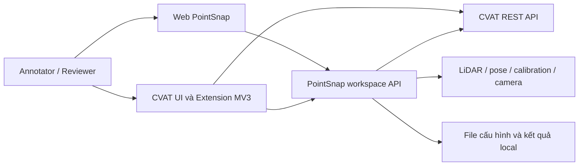
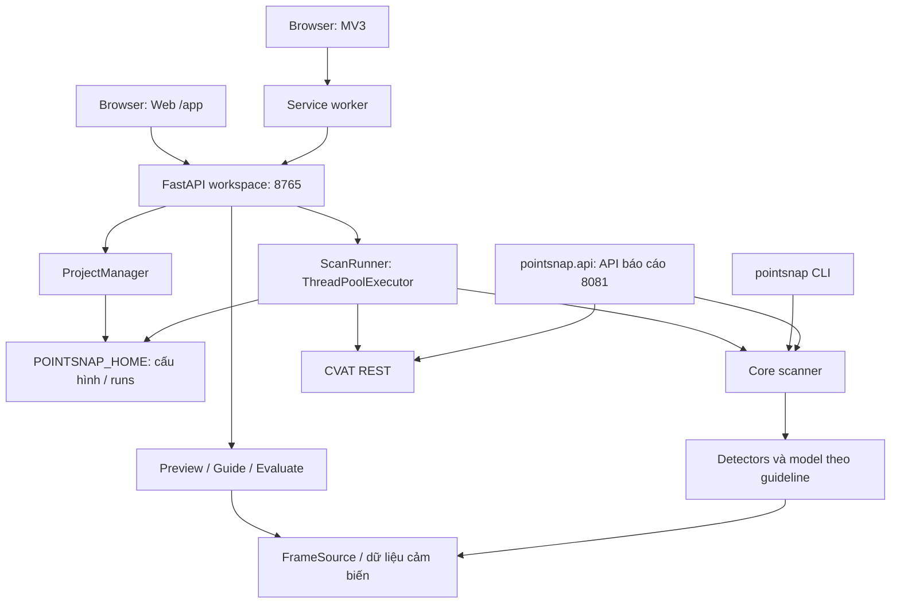
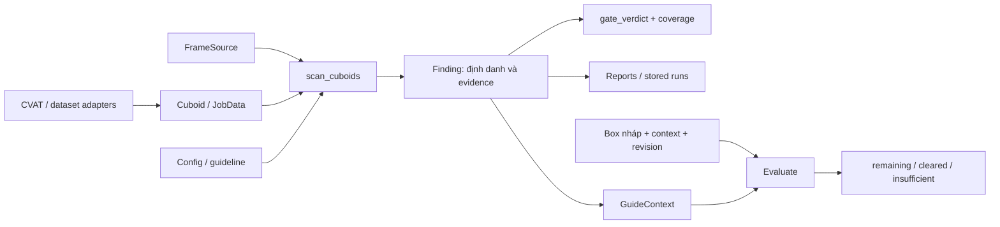

# Architecture Diagrams

Sơ đồ kiến trúc PointSnap 3D 0.3.0, mốc Git ban đầu `98e04f5` ngày 18/10/2026. Working copy có chỉnh sửa chưa commit; xem [phạm vi đối chiếu](tai-lieu/README.md#phạm-vi-đối-chiếu). Mermaid hiển thị trực tiếp trên GitHub. [Thuyết minh kiến trúc](ARCHITECTURE.md), [thiết kế dữ liệu/API](tai-lieu/thiet-ke/SDD.md).

## 1. Bối cảnh hệ thống

Mục đích: thể hiện người dùng, PointSnap và các nguồn ngoài. Tin cậy cao về cấu trúc mã; không khẳng định các dịch vụ đang chạy.



Bằng chứng cạnh: Web/API qua web/app.py và web/static/app.js; extension qua manifest.json/background.js; API đọc CVAT qua web/runner.py và adapters/cvat; sensor qua cli/common.py và FrameSource; lưu qua ProjectManager/runner. CVAT UI lưu sửa tay là phần quy trình ngoài backend PointSnap. Hạ tầng nội bộ CVAT được lược bỏ.

## 2. Thành phần và tiến trình

Mục đích: phân biệt runtime chính với API Docker bổ sung. Tin cậy cao về cấu hình; chưa kiểm deployment ở lần này.



Bằng chứng cạnh: create_app khởi tạo PM/RUN và route guide; runner gọi scan_cuboids; scanner import/call detector; guides đọc frame source; cli/scan_cmd.py gọi scanner; pointsnap/api.py gọi scanner và CVAT. API 8081 được compose/Dockerfile.api cấu hình qua Traefik prefix /pointsnap; Web 8765 chạy bằng CLI ui. Không có cạnh gọi từ Web tới API báo cáo vì chưa thấy bằng chứng.

## 3. Luồng quét, duyệt và sửa tay

Mục đích: mô tả tác dụng phụ và thứ tự. Tin cậy cao, đối chiếu web/app.py, web/runner.py, web/guides.py và manual-repair.

```mermaid
sequenceDiagram
    actor U as Người dùng
    participant W as Web / Extension
    participant A as FastAPI
    participant R as ScanRunner
    participant C as CVAT
    participant D as Scanner / FrameSource
    participant F as File local
    U->>W: Chọn dự án và quét job
    W->>A: POST scans
    A-->>W: 202 và run_id
    A->>R: Xếp hàng
    R->>C: Đọc nhãn đã Save
    R->>F: Lưu snapshot
    R->>D: Nạp dữ liệu, chạy luật và gate
    D-->>R: Findings / coverage
    opt Người dùng yêu cầu gắn cờ
        R->>C: Cập nhật thuộc tính cờ, giữ hình học
    end
    R->>F: Lưu findings, summary, HTML/CSV
    W->>A: Đọc kết quả / guide
    A-->>W: Finding và tham chiếu có bằng chứng
    U->>C: Kéo box bằng CVAT
    W->>A: Evaluate nhãn nháp và revision
    A-->>W: remaining / cleared / insufficient
    U->>C: Save
    W->>A: Sự kiện saved
    Note over W,A: Guide cũ mất hiệu lực; quét lại để cập nhật
```

Runner tạo báo cáo trước bước gắn cờ và lưu findings/summary sau đó; sơ đồ gộp các lần ghi để dễ đọc. Quét lại là yêu cầu mới của người dùng. Mọi route apply-repair/rollback v2 trả 410; không có cạnh backend ghi hình học tự động trong sơ đồ.

## 4. Hợp đồng dữ liệu và hướng đọc mã

Mục đích: chỉ các kiểu dữ liệu và điểm đọc trước khi thay đổi. Tin cậy cao từ core/model.py, core/scanner.py, web/guides.py.



Đường dẫn module đầy đủ ở [danh mục mã nguồn](tai-lieu/ma-nguon.md). Dependency JobData của scanner vẫn trỏ kiểu trong adapter CVAT; sơ đồ này mô tả dữ liệu, không khẳng định package hoàn toàn tách tầng.

## 5. Sơ đồ và thiết kế đã có

- [so-do/pointsnap-flow.png](so-do/pointsnap-flow.png), [bản HTML](so-do/pointsnap-flow.html): giữ nguyên như tài nguyên lịch sử.
- [Kiến trúc thuật toán 14/10](source-tool/pointsnap-3d/docs/ARCHITECTURE.md) và [sơ đồ kỹ thuật cũ](source-tool/pointsnap-3d/docs/ARCHITECTURE_DIAGRAMS.md): đọc theo mốc ghi trong tài liệu.
- [Mockup A13](tai-lieu/thiet-ke/giao-dien-a13/): thiết kế giao diện lịch sử, đã chuyển nguyên nội dung.

Các cạnh tới GPU/model chỉ có ý nghĩa khi guideline/runtime sẵn sàng. Cần xác minh browser/CVAT thật, deployment và precision riêng theo mục 12 của ARCHITECTURE.
