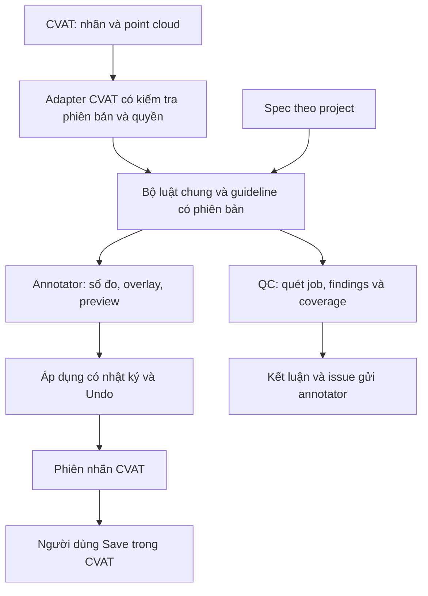

# PointSnap 3D — Bài toán và bản bàn giao phát triển

**Ngày lập:** 26/10/2026  
**Đối tượng đọc:** lập trình viên tiếp nhận, người thiết kế thuật toán, trưởng nhóm gán nhãn và QC.  
**Trạng thái:** bản yêu cầu tổng hợp từ repository và rà soát mã nguồn. Thứ tự triển khai, tiêu chí định lượng và các chức năng mở rộng dưới đây là đề xuất để chốt với chủ dự án; không phải cam kết tiến độ.

**Cập nhật sau nghiên cứu nguồn ngoài:** đọc cùng [báo cáo hoàn thiện dự án](NGHIEN_CUU_HOAN_THIEN_POINTSNAP_3D.md). PointSnap cần quản lý findings/review 3D của mình; CVAT Issues là adapter tùy chọn cần nghiệm thu. Chính sách dữ liệu phải phân biệt cloud, nhãn, findings, journal và metadata host có thể đồng bộ qua browser.

## 1. Bài toán trong một đoạn

Tôi cần phát triển **PointSnap 3D**, công cụ hỗ trợ gán nhãn và kiểm tra chất lượng **3D cuboid trên point cloud LiDAR trong CVAT**. Dữ liệu có thể đã được pre-label, nhưng người gán nhãn vẫn phải sửa nhiều keyframe, căn đáy box, kiểm kích thước/hướng/thuộc tính và rà soát từng track. Công cụ cần giúp họ nhìn rõ sai lệch, sửa có kiểm soát và giảm thao tác lặp lại; người QC cần quét cả job, ưu tiên các vấn đề đáng xem, gửi lỗi về annotator và kiểm tra lại sau khi sửa.

**Nguyên tắc sản phẩm:** tool cung cấp bằng chứng và đề xuất; con người quyết định, áp dụng và Save trong CVAT.

## 2. Người dùng và kết quả họ cần

| Người dùng | Công việc | Kết quả cần đạt |
|---|---|---|
| Annotator | Chỉnh nhãn/pre-label theo từng box và track | Biết sai ở đâu, sửa nhanh, giữ đúng đối tượng khi chuyển frame, hoàn tác được |
| QC / reviewer | Kiểm tra job trước khi chấp nhận hoặc trả về | Danh sách vấn đề có bằng chứng, độ phủ kiểm tra, tiến độ review và kênh gửi lỗi |
| Trưởng nhóm / người quản lý spec | Đặt quy chuẩn cho từng dự án | Class, subtype, thuộc tính, ngưỡng và ngoại lệ thống nhất giữa annotator và QC |
| Người phát triển / vận hành | Bảo trì và bàn giao công cụ | Cài đặt tái lập được, adapter CVAT có kiểm thử, lỗi có thể truy vết và phục hồi |

## 3. Danh mục 18 vấn đề nghiệp vụ

Trạng thái “đã có” nghĩa là có triển khai trong checkout, cần nghiệm thu lại trên CVAT và dữ liệu mục tiêu.

| Mã | Vấn đề | Khả năng cần cung cấp | Hiện trạng |
|---|---|---|---|
| PP-01 | Pre-label tạo keyframe dày, sửa một lỗi phải lặp nhiều frame | Đồng bộ kích thước, làm mượt yaw, tỉa keyframe; gợi ý frame tham chiếu và áp delta theo dải frame | Có ba thao tác đầu; hai khả năng sau cần phát triển |
| PP-02 | Khó căn đáy box trên đường dốc, vỉa hè hoặc LiDAR thưa | Mặt đất tham chiếu, ΔZ có dấu, độ tin cậy và thao tác căn đáy | Có trong extension; cần củng cố độ tin cậy và an toàn |
| PP-03 | Mất dấu đối tượng khi chuyển frame | Giữ lựa chọn đúng track, camera đi theo và giữ góc nhìn/zoom | Đã có |
| PP-04 | Không biết keyframe nào trong track sai | Dải track đánh dấu bất thường, bấm để tới frame | Có kích thước và yaw |
| PP-05 | Khó biết box đã ôm đủ vật hay còn dư | Điểm trong/ngoài box, khoảng hở từng mặt nhìn thấy | Đã có |
| PP-06 | Box chồng nhau hoặc nhiều track cùng gán một vật | Cảnh báo chồng trong frame; phát hiện trùng track qua nhiều frame | Có cảnh báo trong frame; trùng track cần phát triển |
| PP-07 | Kích thước sai class/subtype hoặc không đồng bộ theo track | Kiểm tra theo spec và tham chiếu track | Đã có |
| PP-08 | Hướng box lật hoặc rung bất thường | Phát hiện ngoại lai yaw; đề xuất sửa cho vật cứng, giữ đoạn rẽ thật | Đã có; cần nghiệm thu theo dữ liệu mục tiêu |
| PP-09 | Cao độ box vô lý khi thiếu điểm mặt đất | Kiểm tra cao độ thô theo hệ tọa độ và cấu hình cảm biến | Đã có; phân biệt với phép đo mặt đất cục bộ |
| PP-10 | Box ngoài phạm vi gán nhãn | Kiểm tra khoảng cách/vùng quan tâm theo spec | Có cơ chế; giới hạn thực tế cần chủ dự án chốt |
| PP-11 | Không biết track nào đã xử lý | Đánh dấu xong, chuyển track chưa xong, tiến độ job | Có lưu trong trình duyệt; cần quy tắc mất/khôi phục trạng thái |
| PP-12 | Spec dài, thuộc tính có thể thay đổi theo thời gian | Thẻ spec, kiểm thuộc tính, chỉnh cấu hình theo project; cập nhật thuộc tính theo dải frame | Có spec editor và kiểm thuộc tính; cập nhật theo dải cần phát triển |
| PP-13 | Kéo chuột thiếu chính xác, box mới có kích thước mặc định không phù hợp | Nhập số và mẫu kích thước theo class | Chưa có |
| PP-14 | Pre-label bỏ sót đối tượng | Gợi ý vùng/cụm nghi sót, kèm bằng chứng và giới hạn | Có thử nghiệm Python phụ thuộc dữ liệu/pose; chưa là QC tổng quát |
| PP-15 | QC không biết đã xem phần nào của job | Theo dõi độ phủ review theo track/frame | Chưa có đầy đủ |
| PP-16 | Ghi lỗi và gửi annotator tốn thời gian | Mẫu issue, định danh chính xác đối tượng, bấm để tới lỗi | Cần phát triển luồng bàn giao |
| PP-17 | Nộp lại job khiến QC phải xem lại toàn bộ | So sánh trước/sau, ưu tiên đối tượng và vùng đã thay đổi | Chưa có luồng hoàn chỉnh |
| PP-18 | Báo nhầm và mất kết luận sau quét lại | Kết luận bền theo identity, đo precision từng luật, quản lý ngoại lệ | Có review theo run/index và dismiss cục bộ; cần cơ chế đối chiếu qua lần quét |

## 4. Ràng buộc sản phẩm đã ghi nhận

1. **Luồng annotator chạy ngay trong CVAT bằng extension Chrome/Edge.** Annotator dùng phiên đăng nhập CVAT đang có; các chức năng chính cần hoạt động mà không cài Python hay mở Web Portal.
2. **Dữ liệu được xử lý trong phạm vi CVAT được cho phép.** Luồng chính đọc point cloud/nhãn CVAT đã cung cấp cho tài khoản; việc truyền dữ liệu sang server khác, lưu bản sao hoặc xuất kết quả phải theo chính sách chủ hệ thống.
3. **Sửa có chủ ý:** đo/preview → người dùng Áp dụng → thay đổi trong phiên CVAT → người dùng Save. Mỗi thao tác cần có đường hoàn tác/phục hồi rõ ràng.
4. **Quyền theo tài khoản hiện tại.** Luồng chính cần dùng được trên project có sẵn; khả năng đọc/quét không phụ thuộc vào việc thêm thuộc tính vào schema label.
5. **Annotator và QC dùng cùng luật, ngưỡng, phiên bản guideline.** Cùng đầu vào và cùng mức bằng chứng phải cho kết luận nhất quán; phép kiểm thêm ở cấp job cần được giải thích riêng.
6. **Thiếu bằng chứng phải hiện thành trạng thái riêng.** Phân biệt “không có lỗi phát hiện được” với “chưa kiểm được”.
7. **Tương thích CVAT phải được kiểm thực tế.** Ghi rõ phiên bản đã hỗ trợ; các số đo và lần chạy CVAT được tài liệu cũ báo cáo không thay thế nghiệm thu bản bàn giao mới.

Tài liệu nghiệp vụ gần nhất ưu tiên annotator trước, QC là lớp dùng lại công cụ. Server cạnh CVAT là phương án mở rộng cần chủ dự án xác nhận ranh giới dữ liệu và nhu cầu.

## 5. Đầu vào, đầu ra và định danh

### Đầu vào

- CVAT origin, phiên bản, project/task/job và quyền tài khoản.
- Point cloud theo từng frame; có thể thưa, bị che, chứa mặt đất dốc hoặc nhiều vật sát nhau.
- Cuboid: tâm, kích thước, góc quay, class, thuộc tính, track/shape identity; các trạng thái keyframe, outside, occluded và lock.
- Spec dự án: class/subtype, dải kích thước, thuộc tính bắt buộc/giá trị hợp lệ, cặp chồng được phép, phạm vi gán nhãn và cấu hình cảm biến.
- Camera, calibration, timestamp và pose là dữ liệu bổ sung khi có; mỗi luật công bố rõ nó cần gì.

### Đầu ra

- Số đo và overlay của box đang chọn: ΔZ, điểm trong/ngoài, khoảng hở, hướng và kích thước tham chiếu.
- Kế hoạch thay đổi có preview: đối tượng, frame bị ảnh hưởng, hình học trước/sau, khả năng Undo và các frame bị bỏ qua.
- Finding QC: identity, luật, mức độ, giá trị/ngưỡng, bằng chứng, hướng dẫn và trạng thái review.
- Kết quả job: lỗi/cảnh báo, luật đã bật, độ phủ, phần thiếu dữ liệu, phiên bản spec và trạng thái review.
- Vấn đề gửi lại annotator; báo cáo/xuất file khi chính sách dữ liệu cho phép.

### Hợp đồng dữ liệu cần thống nhất

- Đơn vị nội bộ: mét và radian; giao diện có thể đổi sang cm/độ với nhãn đơn vị rõ ràng.
- Mỗi adapter khai báo hệ tọa độ. Chỉ dùng `bottom_z = center_z - height/2` khi box chỉ quay yaw; roll/pitch cần tính theo góc box hoặc từ chối thao tác chưa hỗ trợ.
- Identity tối thiểu gồm CVAT origin + task/job + loại track/shape + server ID + frame. Phân biệt ID trong trình duyệt với ID lưu trên server.
- Finding thêm rule ID, config/version và revision/chữ ký đầu vào để nhận biết kết quả cũ sau khi nhãn thay đổi.
- ID có thể đổi sau ghi nhãn; không dùng index trong danh sách làm khóa bền qua các lần quét. Nếu đối chiếu không duy nhất thì yêu cầu xem lại.

## 6. Hai luồng làm việc cần hoàn thiện

### A. Annotator chỉnh một track

1. Mở job 3D, chọn spec đúng project và một track cần xử lý.
2. Xem dải track, chọn frame nhìn rõ; công cụ có thể gợi ý frame tham chiếu.
3. Kiểm đáy box, độ khít, kích thước, hướng và thuộc tính bằng số đo/overlay.
4. Chỉnh frame tham chiếu; preview thao tác theo track hoặc dải frame.
5. Áp dụng; nếu phát hiện đầu vào đổi thì cập nhật preview để người dùng xem lại.
6. Kiểm các frame bất thường, Undo khi cần; người dùng Save trong CVAT.
7. Đánh dấu track đã xử lý và chuyển track tiếp theo. “Đã xử lý” là tiến độ công việc, khác với “đã được QC chấp nhận”.

### B. QC kiểm một job

1. Mở job trong CVAT, chọn guideline và các luật khả dụng.
2. Quét cả job; có tiến độ, dừng được, hiển thị frame/luật lỗi hoặc chưa kiểm được.
3. Xem kết quả gộp theo track/vấn đề, lọc theo mức, luật và class.
4. Bấm finding để tới đúng frame/box và xem bằng chứng; QC ghi Đúng / Báo nhầm / Cần xem thêm.
5. Gửi issue về annotator qua cơ chế được hỗ trợ và cấp quyền.
6. Sau khi annotator sửa và Save, QC nhận biết kết quả cũ, quét lại và đối chiếu thay đổi.
7. Kết luận theo tiêu chí dự án, đồng thời công bố phạm vi máy đã kiểm và phạm vi con người đã xem.

## 7. Yêu cầu chức năng và tiêu chí nghiệm thu

**P0:** điều kiện để bản thử nghiệm giải quyết được bài toán cốt lõi an toàn. **P1:** mở rộng giá trị sau P0. **P2:** phụ thuộc dữ liệu, hạ tầng hoặc quyết định nghiệp vụ. Phân loại dưới đây là đề xuất bàn giao.

| ID | Mức | Yêu cầu | Tiêu chí nghiệm thu |
|---|---|---|---|
| R01 | P0 | Kết nối job CVAT hiện có | Đọc đúng nhãn và point cloud bằng quyền tài khoản; chạy trên job không tạo từ export nuScenes của tool; lỗi quyền/phiên bản có thông báo |
| R02 | P0 | Spec theo dự án | Đọc đúng class/thuộc tính, sửa/lưu/import/export được; xóa ngưỡng có hiệu lực; cấu hình sai bị chỉ rõ; cùng spec áp cho annotator và QC |
| R03 | P0 | Đo box đang chọn | Có mặt đất/ΔZ, kích thước, điểm và khoảng hở khi đủ dữ liệu; đổi label/occluded/thuộc tính cập nhật ngay; thiếu dữ liệu được giải thích |
| R04 | P0 | Theo dõi track và tiến độ | Giữ đúng đối tượng khi đổi frame, chỉ ra keyframe nghi sai, chuyển tới được; trạng thái hoàn thành có phạm vi lưu/khôi phục được công bố |
| R05 | P0 | Sửa có preview và phục hồi | Căn đáy, đồng bộ kích thước, mượt yaw, tỉa keyframe giữ các trạng thái ngữ nghĩa; bỏ qua frame lock; lỗi giữa chừng khôi phục được hoặc có nhật ký phần đã ghi |
| R06 | P0 | QC quét cả job trong extension | Dùng bộ luật chung; đọc frame theo lô, có tiến độ và dừng; giữ bộ nhớ bounded; job lớn không làm giao diện mất khả năng thao tác |
| R07 | P0 | Kết luận có coverage | Mỗi luật có trạng thái đã chạy/chưa đủ dữ liệu/không áp dụng/thất bại; job thiếu phép kiểm bắt buộc không được hiển thị như đã kiểm đầy đủ |
| R08 | P0 | Duyệt và định vị finding | Gộp/lọc được, chọn đúng box; lưu Đúng/Báo nhầm/Cần xem thêm; quét lại giữ hoặc đánh dấu cần xem lại bằng identity, không gán nhầm kết luận |
| R09 | P0 | Chuyển lỗi về annotator | Finding panel/store của PointSnap cung cấp luồng 3D đầu cuối, annotator bấm tới đúng đối tượng; nơi lưu/chia sẻ theo policy. Issues API là adapter tùy chọn sau test đầu cuối; export file chỉ bật khi được phép |
| R10 | P1 | Giảm thao tác theo dải frame | Gợi ý frame tốt, nhập số, mẫu kích thước, áp delta/thuộc tính theo dải; hiển thị phạm vi ảnh hưởng và hỗ trợ Undo |
| R11 | P1 | QC cấp job và re-review | Phát hiện nghi trùng track, theo dõi độ phủ người xem, đối chiếu thay đổi giữa hai lần nộp; findings và review cũ có trạng thái rõ ràng |
| R12 | P2 | Sót đối tượng và camera/ML | Mỗi tính năng có bộ dữ liệu nghiệm thu, điều kiện áp dụng và coverage; triển khai theo dữ liệu thực tế được cung cấp |
| R13 | P2 | Server cùng hạ tầng CVAT | Chỉ mở sau quyết định về quyền/dữ liệu; hỗ trợ quét nhiều job, đọc nguồn CVAT trực tiếp và kiểm soát lưu trữ |

### Quy tắc riêng cho trạng thái QA

- Phân biệt: **đạt trong phạm vi kiểm tự động**, **vượt ngưỡng**, **chưa đủ bằng chứng** và **quét bị gián đoạn/thất bại**.
- Hiển thị luật nào bật, bao nhiêu frame/box áp dụng được và vì sao phần còn lại chưa kiểm được.
- Ngưỡng chặn job do chủ dự án/QC xác định theo spec; số lỗi tuyệt đối, lỗi/100 box và loại lỗi nghiêm trọng cần có định nghĩa rõ.
- Việc người dùng dismiss một cảnh báo phải được ghi nhận như một quyết định/ngoại lệ, không được biến thành bằng chứng detector đúng.

## 8. Kiến trúc phát triển đề xuất

- **Hàm thuần:** hình học, mặt đất, điểm của vật, luật kiểm và kế hoạch sửa tách khỏi DOM, mạng và thao tác ghi.
- **Adapter:** gom phụ thuộc Redux/canvas/Three.js/API nội bộ CVAT vào một lớp; có bài test tương thích theo phiên bản.
- **Một nguồn quy tắc:** ưu tiên tái sử dụng module JS đã có cho QC extension. Python dùng sau cần có hợp đồng tương đương và bộ test đối chiếu; không chỉnh hai bộ ngưỡng độc lập.
- **Chạy nền:** đọc và xử lý theo lô; đặt ngân sách cache, giải phóng cloud/overlay không còn dùng; thử Worker nếu đo cho thấy cần.
- **Mở rộng theo dữ liệu:** công bố điều kiện cần của camera, pose, cảm biến và thuật toán; server/ML là tầng tùy chọn.

## 9. Mã hiện có để người tiếp nhận bắt đầu

| Khu vực | Đường dẫn | Vai trò |
|---|---|---|
| Extension đang dùng | `extension/src/annotator/` | Hình học, terrain, checks, point coloring, track ops, adapter, overlay, spec editor và controller |
| Cài đặt và quyền | `extension/hosts.js`, `background.js`, `popup.js`, `options.js` | Cấp quyền host, cấu hình và nạp extension |
| Test extension | `extension/tests/` | Bộ test Node; cần bổ sung controller/adapter và luồng browser |
| Core/backend cũ | `pointsnap/core/`, `detectors/` | Scanner, coverage, geometry và nhiều detector Python |
| Web và báo cáo | `pointsnap/web/`, `report/`, `cli/`, `api.py` | Portal, scan nền, báo cáo, CLI và API |
| Adapter dữ liệu | `pointsnap/adapters/`, `datasets/` | CVAT, nuScenes, PandaSet và export |
| Phần mở rộng | `pointsnap/vision/`, `critic.py`, `learn.py`, `eval/` | Model, học từ review và đánh giá |

### Hiện trạng cần biết trước khi nhận việc

- Extension annotator hiện hoạt động độc lập; bảng QC backend cũ tắt mặc định.
- Backend Python còn phụ thuộc manifest/nguồn nuScenes cho point cloud; chưa phải đường đọc CVAT tổng quát.
- Luật/ngưỡng Python và extension đang lệch nhau; preset VN của Python tắt một số phép kiểm quan trọng.
- Route ghi sửa hình học backend v1 trả HTTP 410; extension hiện có thao tác sửa thật vào phiên nhãn CVAT.
- Bản checkout thiếu bộ test backend/CI được một số tài liệu cũ nhắc tới; có đường dẫn tài liệu/script đã mất.
- Các benchmark trong tài liệu là kết quả lịch sử được dự án báo cáo; cần đo lại trên bản bàn giao và dữ liệu mục tiêu.

## 10. Lỗi nền phải xử lý trong giai đoạn đầu

| Lỗi đã xác minh khi rà soát | Vị trí bắt đầu | Điều kiện đóng |
|---|---|---|
| Chỉ bật `lidar_missing`, thiếu frame vẫn trả gate đạt | `pointsnap/core/scanner.py`: `check_missing`, `scan_coverage_gaps` | Thiếu cloud/pose thành coverage gap; có regression test |
| Ghi nhiều keyframe lỗi giữa chừng làm thay đổi một phần nhưng không trả Undo record | `extension/src/annotator/cvat-adapter.js`: `saveGroup`, `applyEdits` | Test lỗi tại từng bước; giữ nhật ký và phục hồi phần đã ghi |
| Cache giữ checklist cũ khi đổi label/occluded | `extension/src/annotator/annotator.js`: `measureActive` | Mọi đầu vào ảnh hưởng phép đo được đưa vào revision/cache invalidation; test đổi nhãn và trạng thái |
| Xóa khoảng kích thước trong spec editor bị khôi phục | `extension/src/annotator/spec-editor.js`: `setRange` | Thống nhất nghĩa ô trống; xóa rồi Save/tải lại vẫn đúng |
| Đồng bộ kích thước box roll/pitch làm đổi đáy | `extension/src/annotator/track-ops.js`: `planSizeSync` | Giữ đúng đáy theo hình học hoặc chặn rõ thao tác chưa hỗ trợ |

Thêm `.gitignore` phù hợp trước khi tạo `.env`, dataset, snapshot hoặc dữ liệu chạy thử trong repository.

## 11. Bộ tình huống nghiệm thu tối thiểu

1. **Job thật:** đọc/quét job 3D có sẵn, không cần export nuScenes hoặc thêm thuộc tính schema.
2. **Mặt đất:** đường phẳng, dốc, vỉa hè, ít điểm, che khuất và ngoài phạm vi tin cậy; số đo có dấu và trạng thái thiếu bằng chứng.
3. **Track:** có rẽ thật, lật yaw, thay đổi kích thước, outside/occluded/thuộc tính đổi giữa track; tỉa không làm mất các mốc ngữ nghĩa.
4. **Hình học nghiêng:** roll/pitch khác 0 được xử lý đúng hoặc từ chối rõ ràng.
5. **Dữ liệu thay đổi:** đổi label, occluded, spec hoặc kích thước frame khác; checklist/preview cập nhật, không dùng cache cũ.
6. **Sự cố khi ghi:** cho thao tác lỗi ở đầu/giữa/cuối batch; có thể biết chính xác phần đã ghi và phục hồi; Undo giữ những frame người dùng đã sửa tiếp.
7. **Lưu thật:** Apply → Save của CVAT → tải lại trang → nhãn còn đúng; Undo → Save → tải lại cũng đúng.
8. **QC chưa đủ:** thiếu cloud/pose/camera của phép kiểm bắt buộc, thiếu quyền hoặc hủy scan; kết quả không hiển thị như scan đầy đủ.
9. **Nộp lại:** finding còn lỗi, đã sửa, geometry/ID thay đổi và identity mơ hồ; kết luận cũ không gắn nhầm đối tượng.
10. **Khả năng dùng:** job đông box/nhiều điểm, phím tắt CVAT, thu/phóng, responsive và quyền extension; đính kèm profile hiệu năng cùng phiên bản máy/trình duyệt/CVAT.

## 12. Đo thành công bằng gì?

Chưa có baseline được nghiệm thu trên dữ liệu thật của đội. Người nhận việc cần đo trước/sau trên cùng tập job và lưu cấu hình; các mục tiêu giảm thời gian/tăng precision cần chủ dự án chốt sau phép đo ban đầu.

| Chỉ số | Cách đo |
|---|---|
| Thời gian chỉnh track | Thời gian thao tác chủ động tới Save; ghi thêm số keyframe và độ khó |
| Thời gian QC job | Thời gian tới quyết định; ghi số frame/track/box và tỉ lệ lấy mẫu |
| Precision từng luật | Số finding QC xác nhận đúng / số finding đã có kết luận; báo cả mẫu số và phần chưa duyệt |
| Độ phủ detector | Số box/frame kiểm được / số áp dụng được, tách theo luật và lý do thiếu dữ liệu |
| Recall trên tập có đáp án | Dùng lỗi thật được gán đáp án hoặc lỗi chèn có kiểm soát; báo riêng hai loại đánh giá |
| Chất lượng sau nộp | Tỉ lệ lỗi/trả job theo nhóm, đo theo cùng quy trình QC |
| An toàn thao tác | Mọi ca lỗi batch/Undo trong bộ nghiệm thu phục hồi được; kết quả Save/reload khớp |
| Hiệu năng | p50/p95 thời gian đo, tốc độ frame khi scan, bộ nhớ cực đại, độ trễ tương tác trên cấu hình công bố |

**Điều kiện an toàn đề xuất để phát hành pilot:** tất cả ca nghiệm thu về phục hồi batch, identity và thiếu dữ liệu đều đạt. Chốt tập đo và ngưỡng chất lượng riêng trước khi dùng gate cho quyết định bàn giao job.

## 13. Lộ trình và đầu ra bàn giao

| Giai đoạn | Công việc | Bàn giao được khi |
|---|---|---|
| 1. Củng cố annotator | Sửa các lỗi ở mục 10, thống nhất spec, test adapter và Save/Undo thật | Có bản extension ổn định trên phiên bản CVAT mục tiêu cùng bằng chứng nghiệm thu |
| 2. QC cả job | Đọc frame từ CVAT, chạy bộ luật chung, findings/coverage, điều hướng và kết luận | QC hoàn thành được một lượt review ngay trong CVAT |
| 3. Vòng trả lỗi và nộp lại | Hoàn thiện finding panel/store của PointSnap, identity bền và so sánh thay đổi; thử Issues như adapter tùy chọn | Annotator nhận/sửa, QC kiểm lại mà không mất ngữ cảnh |
| 4. Mở rộng có số đo | Luật cấp job, frame tham chiếu, nhập số, thao tác dải frame; camera/pose/server theo nhu cầu | Có lợi ích và độ chính xác được đo trên dữ liệu mục tiêu |

Không có deadline hoặc ngân sách đã chốt trong yêu cầu hiện tại. Người nhận việc cần ước lượng sau khi kiểm quyền truy cập, phiên bản CVAT, dữ liệu mẫu và các quyết định ở mục 14.

Mỗi bản bàn giao cần có: mã nguồn + revision, extension cài được, hướng dẫn chạy, phiên bản hỗ trợ, guideline/version, test/fixture được phép chia sẻ, báo cáo nghiệm thu, lỗi còn biết, cách rollback và số đo hiệu năng. Tài liệu phải mô tả đúng hành vi ghi hình học của extension.

## 14. Những quyết định chủ dự án cần chốt

| Quyết định | Người chốt | Thời điểm |
|---|---|---|
| CVAT mục tiêu, dữ liệu mẫu, quyền annotator/QC và cách truy cập | Chủ dự án + quản trị CVAT | Trước khi nghiệm thu tích hợp |
| “Dữ liệu không rời CVAT” bao gồm những phạm vi nào; findings/file export/server cùng mạng có được phép không | Chủ dữ liệu | Trước mọi thiết kế truyền/lưu dữ liệu ngoài tab |
| Danh sách class/subtype, dải kích thước, ROI, trường hợp chồng box hợp lệ | Người quản lý spec | Trước nghiệm thu detector |
| Quy tắc tiếp đất trên dốc/vỉa hè và xử lý box roll/pitch | QC + người phụ trách dữ liệu | Trước nghiệm thu thao tác hình học |
| Ngưỡng ĐẠT, lấy mẫu hay kiểm 100%, loại lỗi chặn bàn giao | Trưởng nhóm QC | Trước nghiệm thu gate |
| Nơi lưu/chia sẻ finding 3D của PointSnap; quyền và khả năng dùng Issues làm adapter tùy chọn | Chủ dữ liệu + quản trị CVAT + người phát triển | Trước triển khai kênh trả lỗi dùng chung |
| Camera/calibration/pose thực tế có sẵn; có cần xử lý hàng loạt nhiều job không | Chủ dự án | Trước giai đoạn mở rộng |

Các mục này là danh sách bàn giao để ra quyết định, không ngăn việc sửa lỗi nền và củng cố các module hiện có.

## 15. Đề bài ngắn có thể gửi cho người nhận phát triển

> Phát triển tiếp PointSnap 3D để hỗ trợ annotator và QC nhãn cuboid LiDAR ngay trong CVAT. Ưu tiên ổn định extension hiện có: đo mặt đất/độ khít, kiểm spec, theo dõi track, preview và sửa nhiều keyframe có phục hồi khi lỗi. Tiếp theo bổ sung chế độ QC quét cả job bằng cùng bộ luật, đọc dữ liệu trực tiếp từ CVAT, có findings/coverage, kết luận bền và kênh gửi lỗi về annotator. Luồng annotator dùng tài khoản CVAT hiện tại; người dùng tự Save. Phạm vi xử lý và xuất dữ liệu tuân theo chủ hệ thống. Hãy bàn giao theo các giai đoạn, kèm test hồi quy, nghiệm thu Save/Undo trên CVAT mục tiêu và số đo trên dữ liệu thật. Camera/ML/server là phần mở rộng được chốt riêng. Chi tiết yêu cầu và tiêu chí nghiệm thu ở tài liệu này.

## 16. Nguồn và mức độ tin cậy

- [Pain point và hướng giải quyết, cập nhật 25/10/2026](pain-points-va-giai-phap.md): nguồn nghiệp vụ chính, gồm 18 pain point và ràng buộc dữ liệu.
- [Phân tích và thiết kế lại QC, 25/10/2026](qc-scan-phan-tich-thiet-ke.md): hướng QC trong extension; server là tầng tùy chọn.
- [Extension README](../extension/README.md): tính năng annotator hiện tại; phần QC cũ ở cuối cần đọc theo trạng thái lịch sử.
- [Quy ước tọa độ và dữ liệu](CONVENTIONS.md), [phạm vi bảo mật backend local](local-security.md).
- Hiện trạng code và lỗi ở mục 10 dựa trên rà soát ngày 26/10/2026. Kiểm tra đã chạy: 126 test extension đạt, 84 file Python parse được, 3 file JS Web qua kiểm tra cú pháp, Compose qua kiểm tra cấu hình; chưa chạy nghiệm thu đầu cuối CVAT/GPU/dữ liệu thật trong đợt rà soát này.

Khi tài liệu cũ và code khác nhau, người nhận việc cần ghi lại quyết định sản phẩm và cập nhật yêu cầu/test tương ứng; không lấy số liệu demo lịch sử làm cam kết chất lượng hiện tại.
