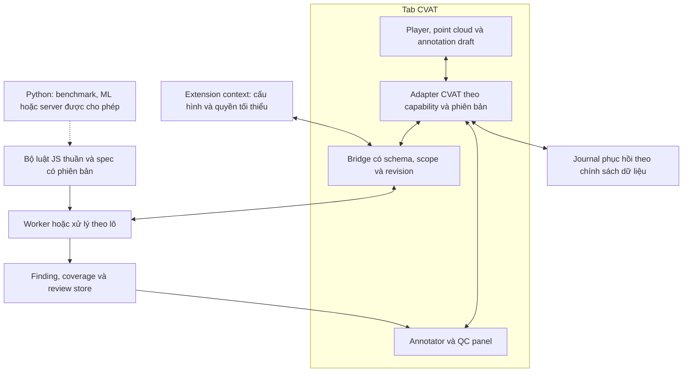

# PointSnap 3D — Nghiên cứu và thiết kế hoàn thiện dự án

**Ngày:** 26/10/2026 · **37 truy vấn, 37 nguồn sơ cấp duy nhất được giữ lại.**  
**Mã tham chiếu:** `0f9f8bece45bb9d34eeee84d3da4d632180adb3f` · extension `0.5.0`, Python package `0.3.0`.  
**Mục đích:** giúp chủ dự án và đội nhận phát triển chọn kiến trúc, chia việc và nghiệm thu. Đây là kết quả nghiên cứu/thiết kế; các giải pháp đề xuất chưa được triển khai hay benchmark mới.

## Đọc tài liệu theo thứ tự

1. Báo cáo này: kết luận, căn cứ, kiến trúc và quyết định.
2. [Kế hoạch triển khai và nghiệm thu](research-2026-10-26/KE_HOACH_TRIEN_KHAI_VA_NGHIEM_THU.md): backlog, hợp đồng dữ liệu, test, benchmark và điều kiện phát hành.
3. [Bài toán bàn giao](BAI_TOAN_VA_BAN_GIAO_PHAT_TRIEN.md): người dùng, 18 pain point và 13 yêu cầu chức năng.
4. Evidence chi tiết: [CVAT](research-2026-10-26/cvat-evidence.md), [extension](research-2026-10-26/extension-evidence.md), [LiDAR](research-2026-10-26/lidar-evidence.md), [sản phẩm và phương pháp](research-2026-10-26/product-method-evidence.md).

## 1. Kết luận điều hành

**Hướng phù hợp nhất với ràng buộc hiện có là phát triển tiếp extension annotator, dùng chung core JS cho QC cả job, và giữ Python cho đánh giá/ML hoặc server tùy chọn.** Đây là khuyến nghị thiết kế dựa trên [bài toán nghiệp vụ](pain-points-va-giai-phap.md), [phân tích QC nội bộ](qc-scan-phan-tich-thiet-ke.md) và bằng chứng bên dưới, không phải kết luận mọi dự án CVAT đều nên dùng extension.

Năm việc phải giải quyết trước khi mở rộng:

1. **Phục hồi sửa nhiều keyframe:** journal trước mutation, ghi rõ phần đã đổi và xử lý xung đột. Undo của CVAT không cung cấp giao dịch nhiều frame mà PointSnap có thể mặc định dựa vào. [Source history](https://raw.githubusercontent.com/cvat-ai/cvat/develop/cvat-core/src/annotations-history.ts)
2. **QC 3D do PointSnap quản lý:** tài liệu CVAT hiện giới hạn native Review ở ngoài task 3D; native automated quality estimation cũng chỉ cho 2D. [Manual QA](https://docs.cvat.ai/docs/qa-analytics/manual-qa/), [Automated QA](https://docs.cvat.ai/docs/qa-analytics/auto-qa/)
3. **Một rule engine và spec có phiên bản:** tránh tình trạng annotator thấy ổn nhưng backend báo lỗi vì thuật toán/ngưỡng khác. Đây là khoảng cách đã ghi nhận trong [tài liệu QC hiện tại](qc-scan-phan-tich-thiet-ke.md).
4. **Coverage có hiệu lực với gate:** thiếu dữ liệu hoặc bị hủy phải dẫn tới trạng thái chưa kiểm đủ; không dùng danh sách finding rỗng làm bằng chứng đạt. [Scanner hiện tại](../pointsnap/core/scanner.py)
5. **Khóa dữ liệu nghiệm thu mới và chính sách lưu trữ:** các kết quả lịch sử chưa chứng minh chất lượng trên dữ liệu đội; journal, findings và metadata host cũng cần có phạm vi lưu/đồng bộ rõ ràng. [Đối chiếu holdout](research-2026-10-26/lidar-evidence.md), [Chrome Storage](https://developer.chrome.com/docs/extensions/reference/api/storage)

**Mức tin cậy:** cao cho giới hạn nền tảng được tài liệu/source công bố và các quan sát code; trung bình cho lựa chọn kiến trúc đề xuất; chưa đủ bằng chứng để cam kết precision, tốc độ scan hay thời gian tiết kiệm trên dữ liệu mục tiêu.

## 2. Bài toán cần tối ưu

Đơn vị thao tác chính là **một track**, gồm nhiều frame có hình học, thuộc tính và trạng thái khác nhau. Annotator cần nhìn rõ vấn đề, giảm các thao tác lặp, và giữ quyền quyết định. QC cần biết phần nào đã kiểm, vấn đề nào đã xác nhận, thay đổi nào cần xem lại và ai nhận sửa. [Nguồn nghiệp vụ](pain-points-va-giai-phap.md), [bản bàn giao](BAI_TOAN_VA_BAN_GIAO_PHAT_TRIEN.md)

### Những tính chất phải giữ

- Dữ liệu chính lấy từ job CVAT được tài khoản cấp quyền; annotator dùng extension ngay trong job.
- Preview và Áp dụng là thao tác chủ ý; **Save của CVAT là ranh giới riêng** cần kiểm chứng.
- Box ít điểm/che khuất và luật thiếu đầu vào có quyền từ chối kết luận.
- Tiến độ annotator, kết luận một finding và chấp nhận job là ba loại trạng thái riêng.

Đây là yêu cầu tổng hợp từ tài liệu nội bộ, không phải các chức năng hiện tại đã hoàn chỉnh.

## 3. Hiện trạng và khoảng cách tới sản phẩm bàn giao

| Khu vực | Đã có trong checkout | Khoảng cách cần đóng |
|---|---|---|
| Annotator | Terrain, số đo, tô điểm, dải track, size sync/yaw/thinning, spec editor | Journal/recovery, cache đủ đầu vào, box nghiêng, đồng nhất spec, test adapter thực |
| QC | Backend scan, findings, gate, review và báo cáo | Nguồn frame CVAT tổng quát; QC extension dùng luật chung; identity qua lần nộp; kênh phản hồi |
| Dữ liệu | CVAT annotations, nuScenes/manifest, PandaSet reader | Mapping frame/chunk và quyền thực tế; nguồn draft so với bản đã Save; pose/camera capability |
| Đánh giá | Test logic extension, eval và corruption Python | Test backend/CI bị thiếu trong checkout; cần holdout mới, test browser và chỉ số người dùng |
| Triển khai | MV3, Python/FastAPI, Docker/Compose | Ma trận CVAT/browser, reproducible build, tài liệu đúng hành vi, chính sách lưu nhãn/metadata |

Nguồn cục bộ: [extension README](../extension/README.md), [adapter](../extension/src/annotator/cvat-adapter.js), [controller](../extension/src/annotator/annotator.js), [QC design](qc-scan-phan-tich-thiet-ke.md), [pyproject](../pyproject.toml).

Các lỗi batch, cache, xóa range và box nghiêng đã được tái hiện trong đợt review trước cùng ngày. Nghiên cứu này kế thừa bằng chứng đó; không tuyên bố các lỗi đã được sửa.

## 4. Phát hiện từ nguồn ngoài làm thay đổi thiết kế

### 4.1 Native CVAT QA không là đường hoàn chỉnh cho review LiDAR

Theo hai trang QA hiện hành, Review mode không áp dụng cho 3D và automated quality estimation chỉ hỗ trợ 2D. **Hệ quả đề xuất:** PointSnap có list, overlay, review state và điều hướng 3D riêng. [Manual QA](https://docs.cvat.ai/docs/qa-analytics/manual-qa/), [Automated QA](https://docs.cvat.ai/docs/qa-analytics/auto-qa/)

Issues API có CRUD, nhưng chưa đủ để chứng minh annotator nhìn thấy và resolve issue trên canvas 3D. Giữ Issues như adapter tùy chọn sau một thử nghiệm đầu cuối, thay vì điều kiện mặc định để MVP hoạt động. [Issues API](https://docs.cvat.ai/docs/api_sdk/sdk/reference/apis/issues-api/)

### 4.2 Có đường đọc frame CVAT, nhưng chưa phải XYZ dùng ngay

Jobs API cung cấp data/meta; tài liệu mới dùng chunk `index` theo job. Mã frame frontend có kiểu Blob/ImageBitmap và logic decode/cache, nên cần reader/decoder cùng hợp đồng mapping thay vì giả định mọi `data()` đều là XYZ. [Jobs API](https://docs.cvat.ai/docs/api_sdk/sdk/reference/apis/jobs-api/), [frames.ts](https://raw.githubusercontent.com/cvat-ai/cvat/develop/cvat-core/src/frames.ts)

**Đề xuất spike:** so reader dùng cvat-core với reader REST cùng origin/session, đo khi player chuyển frame đồng thời. Cả hai phải qua job start khác 0, frame step, deleted frame, chunk cuối và lỗi quyền. Source frontend cho thấy scan và player có thể cạnh tranh decode; đây là rủi ro cần thử, chưa là lỗi thực tế đã tái hiện trong PointSnap. [Phân tích C04–C05](research-2026-10-26/cvat-evidence.md)

### 4.3 Chỉnh state frontend không đồng nghĩa lưu server

Source CVAT mô tả history/save state ở frontend; transaction history chỉ chấp nhận cùng frame. **Thiết kế đề xuất:** tách trạng thái applied trong phiên, yêu cầu Save, và xác minh reload; phục hồi nhiều frame là trách nhiệm có kiểm thử của PointSnap. [History](https://raw.githubusercontent.com/cvat-ai/cvat/develop/cvat-core/src/annotations-history.ts), [Annotations collection](https://github.com/cvat-ai/cvat/blob/develop/cvat-core/src/annotations-collection.ts)

### 4.4 Lời hứa về dữ liệu cần chính xác hơn

Chrome có thể đồng bộ `storage.sync` giữa browser cùng tài khoản; code PointSnap hiện dùng nó cho danh sách origin CVAT. MAIN world dùng chung môi trường với trang. **Đề xuất:** local-only là chế độ triển khai mặc định cho dữ liệu khách hàng; bridge chỉ nhận lệnh phạm vi hẹp và không đặt bí mật ở MAIN. [Chrome Storage](https://developer.chrome.com/docs/extensions/reference/api/storage), [ExecutionWorld](https://developer.mozilla.org/en-US/docs/Mozilla/Add-ons/WebExtensions/API/scripting/ExecutionWorld), [hosts.js](../extension/hosts.js)

Đây là phân biệt giữa raw point cloud, nhãn, findings, cấu hình và metadata; chưa phát hiện raw cloud bị gửi ra ngoài trong nghiên cứu này.

## 5. Học gì từ công cụ khác?

| Nguồn tham khảo | Khả năng được bên phát triển công bố | Bài học đề xuất cho PointSnap |
|---|---|---|
| [SUSTechPOINTS](https://github.com/naurril/SUSTechPOINTS) | 9 DoF, batch edit, focus và box fitting | Giữ context đối tượng và giảm thao tác lặp; kiểm đủ hình học nghiêng |
| [Segments.ai cuboid](https://docs.segments.ai/how-to-annotate/label-3d-point-clouds/3d-point-cloud-cuboid-interface) | Preset kích thước, các chế độ initialization/adjust khác nhau | Nút sửa cần công bố những tham số đổi và điều kiện bằng chứng |
| [Segments.ai batch](https://docs.segments.ai/how-to-annotate/label-3d-point-clouds/batch-mode-for-dynamic-objects) | Xem một đối tượng qua nhiều frame | Dải track/khung xem nhanh nên giúp chọn frame tham chiếu và tìm ngoại lai |
| [Segments.ai QA](https://docs.segments.ai/guides/manage-qa-processes) | Vòng sửa lại rồi reviewer kiểm lại; lint và review status | Lưu revision và trạng thái trả lỗi để re-review có ngữ cảnh |
| [LATTE](https://arxiv.org/abs/1904.09085) | Nghiên cứu giảm lặp bằng tracking và hỗ trợ annotation | Đo năng suất end-to-end, không chỉ thời gian chạy detector |

Đây là đối chiếu khả năng/UX từ nguồn chính thức, không là benchmark cạnh tranh hay đề xuất chuyển nền tảng. Chưa có dữ liệu để so chi phí mua dịch vụ với phát triển nội bộ. [Evidence sản phẩm](research-2026-10-26/product-method-evidence.md)

## 6. Kiến trúc được đề xuất



Các mũi tên giữa bridge/worker là hợp đồng đề xuất; worker loading/CSP và nguồn frame phải được spike trên CVAT mục tiêu. Python không trực tiếp import JS ở sơ đồ này: dùng chung spec/schema và test đối chiếu hoặc triển khai runner JS riêng khi cần.

### So sánh lựa chọn

| Phương án | Lợi ích trong bối cảnh này | Chi phí/rủi ro | Quyết định đề xuất |
|---|---|---|---|
| Extension + core JS chung | Tái dùng code annotator, ở trong workflow hiện tại | Nội bộ CVAT, quyền/CSP, browser memory | Chọn cho P0 và QC MVP |
| Python/Web là trung tâm ngay | Tái dùng backend, phù hợp ML/batch | Nguồn cloud, PAT, hai engine, vận hành server | Giữ cho benchmark và tầng mở rộng |
| Plugin/fork CVAT do đội quản trị | Kiểm soát tích hợp sâu hơn | Cần quyền triển khai, bảo trì theo bản CVAT | Xem lại khi đội sở hữu CVAT chấp thuận |
| Đổi sang nền tảng khác | Có thể có batch/QA tích hợp | Di chuyển dữ liệu, quy trình, quyền và chi phí chưa biết | Chưa có cơ sở thay ràng buộc CVAT |

Đây là đánh giá thiết kế, không là điểm số định lượng. CVAT có plugin entrypoint cung cấp core/store/actionCreators; vẫn cần pin phiên bản cho phụ thuộc nội bộ. [Plugin source](https://raw.githubusercontent.com/cvat-ai/cvat/develop/cvat-ui/src/components/plugins-entrypoint.tsx)

### Ranh giới module

- `domain`: cuboid, identity, units, coordinate metadata và revision.
- `rules`: hàm thuần, điều kiện đầu vào, evidence, result và đề xuất hình học.
- `guideline`: schema/version/hash, kế thừa và import/export.
- `cvat-adapter`: đọc frame/annotation, selection/camera, capability, mutation/Save observation.
- `scan`: scheduler, worker, cache giới hạn byte, cancellation và checkpoint được phép.
- `review`: finding identity, trạng thái duyệt, reconciliation, issue adapter và export policy.
- `ui`: overlay/panel, phím tắt, trạng thái loading/insufficient/stale/conflict.

Tên module là thiết kế đích; di chuyển code từng bước với regression test, không cần viết lại toàn bộ bằng framework mới.

## 7. Thiết kế thuật toán và bằng chứng hình học

### 7.1 Terrain

Giữ `terrain.js` làm baseline. Mã dùng lưới một frame và các heuristic riêng; gọi là **lưới cao độ một frame lấy cảm hứng từ GroundGrid**. Bài GroundGrid có các thành phần và điều kiện thực nghiệm khác; không chuyển tốc độ/độ chính xác bài báo thành cam kết cho JS. [GroundGrid](https://arxiv.org/html/2405.15664v1), [đối chiếu mã](research-2026-10-26/lidar-evidence.md)

**Đề xuất thí nghiệm:** so baseline hiện tại, cải tiến có giới hạn, RANSAC hiện có và các baseline native. Patchwork++ là ứng viên đối chiếu ground mask; protocol xử lý vegetation và cấu hình sensor cần khóa trước khi so. [Patchwork++ usage](https://github.com/url-kaist/patchwork-plusplus/blob/master/USAGE.md)

Đo riêng: ground segmentation, sai số cao độ dưới box, và precision finding QC. Một thuật toán ground mask tốt chưa tự chứng minh chất lượng thao tác căn box.

### 7.2 Độ khít và mặt khuất

**Suy luận hình học:** nếu chỉ quan sát một mặt của vật, nhiều cuboid khác nhau có thể chứa cùng tập điểm. Do đó extent của điểm không xác định duy nhất kích thước thật. Dùng mặt thấy được, track/spec và confidence; gợi ý tâm/yaw phải kèm giới hạn.

L-shape là một baseline fit trục/mặt cho vật cứng; cần đánh giá đủ ca ít điểm, vật sát nhau và hướng đối xứng. Nguồn tác giả xác nhận bài toán tối ưu, không xác nhận precision của PointSnap. [CMU L-shape](https://publications.ri.cmu.edu/efficient-l-shape-fitting-for-vehicle-detection-using-laser-scanners)

### 7.3 Roll/pitch và tiếp đất

**Suy luận giải tích:** với rotation matrix `R`, chiều dài/rộng/cao `l,w,h`, min-Z của cuboid là:

```text
minZ = centerZ - (abs(R31)*l + abs(R32)*w + abs(R33)*h)/2
```

Giữ `centerZ-h/2` chỉ đủ trong trường hợp chỉ quay yaw. Phải phân biệt giữ min-Z với “tiếp đất đúng trên dốc”; lựa chọn mặt tựa và dung sai cần spec. Đề xuất MVP chặn thao tác chưa hỗ trợ box nghiêng, rồi triển khai công thức đầy đủ có fixture. [Bằng chứng và test hình học](research-2026-10-26/lidar-evidence.md)

### 7.4 Thời gian và chuyển hệ

Sensor/ego/global không thể trộn khi kiểm chuyển động hoặc gộp frame. nuScenes gắn calibration/pose với metadata thời gian; AV2 Sensor có quy ước ego và bù chuyển động riêng. Adapter cần tránh bù hai lần. [nuScenes tutorial](https://www.nuscenes.org/tutorials/nuscenes_tutorial.html), [AV2 Sensor](https://argoverse.github.io/user-guide/datasets/sensor.html)

Tỉa keyframe cần khớp chính xác nội suy CVAT, gồm góc Euler qua ±π và mốc outside/occluded/thuộc tính. Giữ test đối chiếu source/tag CVAT thay vì thay phép nội suy theo trực giác. [Cuboid track](https://raw.githubusercontent.com/cvat-ai/cvat/develop/cvat-core/src/annotations-objects/cuboid-track.ts)

## 8. Độ tin cậy của extension

### Phục hồi sửa theo track

Quy trình đề xuất:

```text
PREPARED → APPLYING → APPLIED_UNSAVED → SAVE_UNVERIFIED → PERSISTED_VERIFIED
                 ↘ RECOVERING → RESTORED hoặc CONFLICT
```

- Ghi journal được phép trước mutation đầu; giữ pre/post-state, identity, revision, plan hash và trạng thái từng entry.
- Đọc fresh state trước Apply; đầu vào đổi thì yêu cầu xem lại preview.
- Khi lỗi, phục hồi có so sánh post-state; giữ thay đổi người dùng/phiên khác, công bố entry xung đột.
- Journal RAM chỉ bảo đảm trong vòng đời phiên còn sống. Phục hồi qua reload cần được cho phép lưu nhãn local/server; nếu chính sách không cho, công bố giới hạn và thu hẹp thao tác.
- Chỉ gọi `PERSISTED_VERIFIED` khi adapter có bằng chứng bản đã lưu phù hợp; tối thiểu nghiệm thu Save/reload trong browser. Các API quan sát Save cụ thể phải được kiểm theo phiên bản.

Đây là thiết kế bù phục hồi, không cam kết transaction server atomic. [Phân tích mutation](research-2026-10-26/extension-evidence.md), [CVAT collection](https://github.com/cvat-ai/cvat/blob/develop/cvat-core/src/annotations-collection.ts)

### Bridge, worker và cache

- MAIN chỉ giữ phần cần tương tác CVAT. Message schema có scope/revision, giới hạn payload và allowlist hành động; message cùng origin không xác thực được tác giả bên trong trang. [Messaging](https://developer.chrome.com/docs/extensions/develop/concepts/messaging#security-considerations)
- Service worker giữ chức năng quyền/điều phối ngắn; tiến độ quan trọng có vòng đời rõ, không chỉ nằm trong global có thể mất khi worker dừng. [Lifecycle](https://developer.chrome.com/docs/extensions/develop/concepts/service-workers/lifecycle)
- Worker nhận bản sao buffer PointSnap sở hữu, không detach buffer CVAT đang render. Kết quả trả kèm generation; đổi job/spec thì bỏ response cũ. [Transferables](https://developer.mozilla.org/en-US/docs/Web/API/Web_Workers_API/Transferable_objects)
- Cache bao gồm cloud, geometry/label/occluded/attrs, các box loại khỏi terrain, tham chiếu track, guideline và engine revision; tất cả có giới hạn bộ nhớ.
- Host permission theo origin và thao tác người dùng; bridge network không nhận URL tùy ý. [Permissions](https://developer.chrome.com/docs/extensions/reference/api/permissions), [Network requests](https://developer.chrome.com/docs/extensions/develop/concepts/network-requests)

## 9. QC, coverage và vòng nộp lại

### Rule result và gate

Mỗi luật trả một execution result, kể cả không tìm được lỗi: số áp dụng được, số đã kiểm, số abstain/thất bại và lý do. Finding là sản phẩm con của execution result. **Đề xuất gate:** `PASS_IN_SCOPE`, `FAIL`, `INCOMPLETE`; `CANCELLED/FAILED/STALE` là trạng thái run, không ép về PASS/FAIL. Chi tiết schema và test nằm trong [kế hoạch nghiệm thu](research-2026-10-26/KE_HOACH_TRIEN_KHAI_VA_NGHIEM_THU.md).

### Review bền

Identity gồm origin/project/task/job, track/shape, server ID, frame/window và rule. Review gắn revision đầu vào; geometry, spec hay engine đổi thì reconcile hoặc đánh dấu cần xem lại. Nếu CVAT đổi ID, chỉ khôi phục liên kết khi đối chiếu duy nhất; không ghép theo index hay nhãn gần giống. [Khoảng cách PP-17/18](pain-points-va-giai-phap.md)

**Kênh chính đề xuất:** PointSnap finding store và panel 3D; lưu dùng chung phải ở nơi chủ dữ liệu cho phép. CVAT Issues là adapter đã nghiệm thu mới bật. File JSON/CSV chỉ là kênh được cho phép theo từng triển khai, không mặc định tương thích với mọi chính sách dữ liệu. [Issues API và giới hạn](research-2026-10-26/cvat-evidence.md)

## 10. Kế hoạch đo chất lượng

### Tập dữ liệu

1. Geometry fixtures có đáp án giải tích, corruption có seed.
2. Public scenes/logs khóa trước tuning; tách theo scene/log.
3. Holdout dữ liệu thật của đội, có QC độc lập và xử lý bất đồng.

`TEST_SCENES` của Python có `scene-1077/1100`, trong khi tài liệu ghi extension đã hiệu chỉnh sau khi kiểm các cảnh đó. **Đối với bộ luật extension đã hiệu chỉnh và bản hợp nhất tương lai, các cảnh này không còn là holdout nguyên vẹn.** Không suy ra ngưỡng Python hiện tại cũng đã được chỉnh như vậy. [Đối chiếu cụ thể](research-2026-10-26/product-method-evidence.md), [nguyên tắc chia nhóm](https://scikit-learn.org/stable/modules/generated/sklearn.model_selection.GroupKFold.html)

### Chỉ số cần có

- Terrain: bias, MAE/p95, observed/interpolated coverage theo range/slope/occlusion.
- Findings: precision, recall trên phần đã có đáp án, false alarms/100 box, mẫu số theo luật/class/severity.
- Sửa box: sai số trước/sau và **tỉ lệ làm nhãn xấu hơn**, không chỉ tỉ lệ thành công của thao tác.
- UX: thời gian chủ động tới Save, số thao tác, lỗi còn lại sau QC; thử theo thứ tự đối trọng.
- Hệ thống: p50/p95 latency, scan throughput, peak memory, cancel latency, Save/reload và recovery outcomes.

nuScenes detection matching/ATE dùng tâm 2D; vì vậy cần metric đứng riêng cho Z-grounding. AV2 raster có độ phân giải/phạm vi và yêu cầu chuyển hệ riêng; chỉ chấm nơi tham chiếu hợp lệ. [nuScenes metrics](https://github.com/nutonomy/nuscenes-devkit/blob/master/python-sdk/nuscenes/eval/detection/README.md), [AV2 maps](https://argoverse.github.io/user-guide/api/hd_maps.html)

Báo tỷ lệ cùng cỡ mẫu và bất định; Wilson là một phương án cho tỷ lệ theo điều kiện thống kê thích hợp. Finding liên tiếp cùng track cần xử lý phụ thuộc nhóm khi ước lượng. Mẫu chỉ chọn finding đã báo không đo được lỗi bị bỏ sót trong toàn job. [NIST intervals](https://www.itl.nist.gov/div898/handbook/prc/section2/prc241.htm)

## 11. Lộ trình có điều kiện kết thúc

| Mốc | Kết quả bàn giao | Điều kiện chuyển mốc |
|---|---|---|
| M0 — Quyết định nền | CVAT target, data boundary, role matrix, test fixtures | Có quyền và policy đủ để nghiệm thu mutation/reader |
| M1 — Annotator đáng tin | Đóng lỗi batch/cache/spec/tilt; CI và adapter contract | Save/Undo/reload, lỗi giữa batch và stale response đều qua |
| M2 — QC trong extension | Reader đã chọn, shared rules, scheduler, findings và coverage | Quét job có sẵn; cancel/thiếu dữ liệu không tạo false pass |
| M3 — Review vòng kín | Review revision, trả lỗi, re-review, tiến độ | Annotator sửa và QC đối chiếu được; không gán nhầm quyết định cũ |
| M4 — Pilot có số đo | Báo cáo target holdout, usability/performance và lỗi còn biết | Chủ dự án chốt ngưỡng theo chất lượng/chi phí thực tế |
| M5 — Mở rộng | Luật cấp job, numeric/batch view, pose/camera/server | Có nhu cầu và dữ liệu chứng minh đầu tư tiếp hợp lý |

Không có dữ liệu về nhân lực, quyền hay deadline để cam kết số tuần. Backlog chi tiết và dependency graph nằm trong [kế hoạch triển khai](research-2026-10-26/KE_HOACH_TRIEN_KHAI_VA_NGHIEM_THU.md).

## 12. Những quyết định chủ dự án cần chốt

| Quyết định | Đề xuất mặc định để bắt đầu | Bằng chứng cần có |
|---|---|---|
| CVAT/browser mục tiêu | Một bản CVAT cố định và browser được quản trị hỗ trợ | Version/tag, quyền, bộ job mẫu và fixture |
| Metadata host có được đồng bộ? | Local-only cho triển khai dữ liệu khách hàng | Policy Chrome/Edge sync và dữ liệu được lưu |
| Journal qua reload được lưu đâu? | Local chỉ khi chủ dữ liệu cho phép; nếu không, giới hạn và nói rõ | Retention, cleanup, quyền truy cập và tình huống phục hồi |
| QC dùng chung giữa người dùng? | Store cùng hạ tầng được phê duyệt | Identity, quyền, đồng thời, backup và retention |
| Ngưỡng chấp nhận và phạm vi kiểm | Tách phạm vi máy kiểm khỏi quyết định QC | Spec, cost báo nhầm/bỏ sót, holdout và mức lấy mẫu |
| Pose/camera/server cần ngay? | Theo capability, thêm sau đường LiDAR/annotation cơ bản | Metadata thật, chất lượng calibration và nhu cầu vận hành |

Đây là danh sách quyết định để triển khai, không yêu cầu dừng nghiên cứu hoặc các sửa lỗi nền độc lập.

## 13. Phương pháp và giới hạn nghiên cứu

- Dùng `deep-research`, kết hợp `engineering-system-design`, `engineering-testing-strategy` và `engineering-documentation`.
- Exa/Firecrawl không có trong phiên; dùng công cụ web để tìm kiếm, mở nguồn gốc và đối chiếu. Không cài plugin hoặc gửi dữ liệu dự án lên nhà cung cấp nghiên cứu.
- Bốn nhánh: CVAT 10 truy vấn/12 nguồn; extension 8/9; LiDAR 11/9; sản phẩm/phương pháp 8/8. Tổng 37 truy vấn; 38 thẻ nguồn tương ứng **37 URL tài liệu duy nhất** sau gộp nguồn nuScenes trùng và mirror raw/HTML.
- Chỉ giữ paper, nguồn tác giả, tài liệu/repository chính thức và code của dự án. Ưu tiên tài liệu nền tảng hiện hành; paper cũ dùng làm baseline lý thuyết, không tuyên bố là SOTA năm 2026.
- Đã đọc sâu phương pháp/đánh giá GroundGrid, protocol Patchwork++, docs CVAT/source history-frame-interpolation, browser storage/lifecycle và QA workflow. L-shape PDF timeout, chỉ xác nhận trang tác giả; LATTE dùng abstract gốc.
- Nguồn `develop/master/stable` là tài liệu sống truy cập 26/10/2026; triển khai phải pin commit/tag tương ứng CVAT đang chạy.
- Không có truy cập CVAT công ty, raw dataset mục tiêu, GPU hay quyền triển khai trong nghiên cứu. Không chạy benchmark mới, không xác nhận Issues 3D, không xác nhận worker CSP. Kết quả review trước cùng ngày gồm 126 test extension đạt và kiểm cú pháp/config; không chứng nhận chất lượng dữ liệu thật.

**Cách đọc bằng chứng:** fact có nguồn trực tiếp; nhận xét code có file đối chiếu; suy luận/thiết kế được gắn nhãn đề xuất; những gì chưa đo được giữ thành thử nghiệm hoặc quyết định cần chốt.
