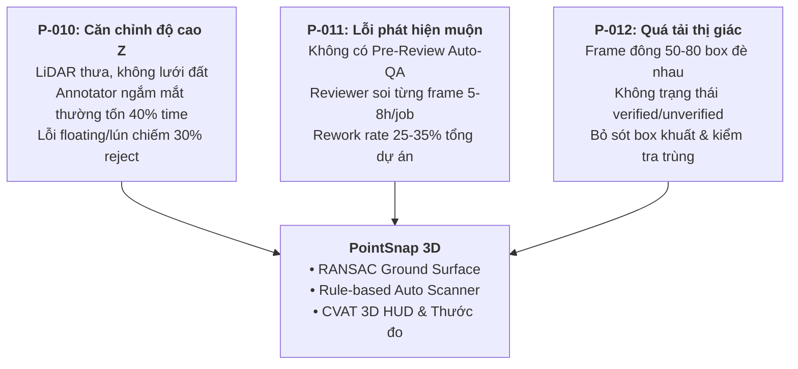
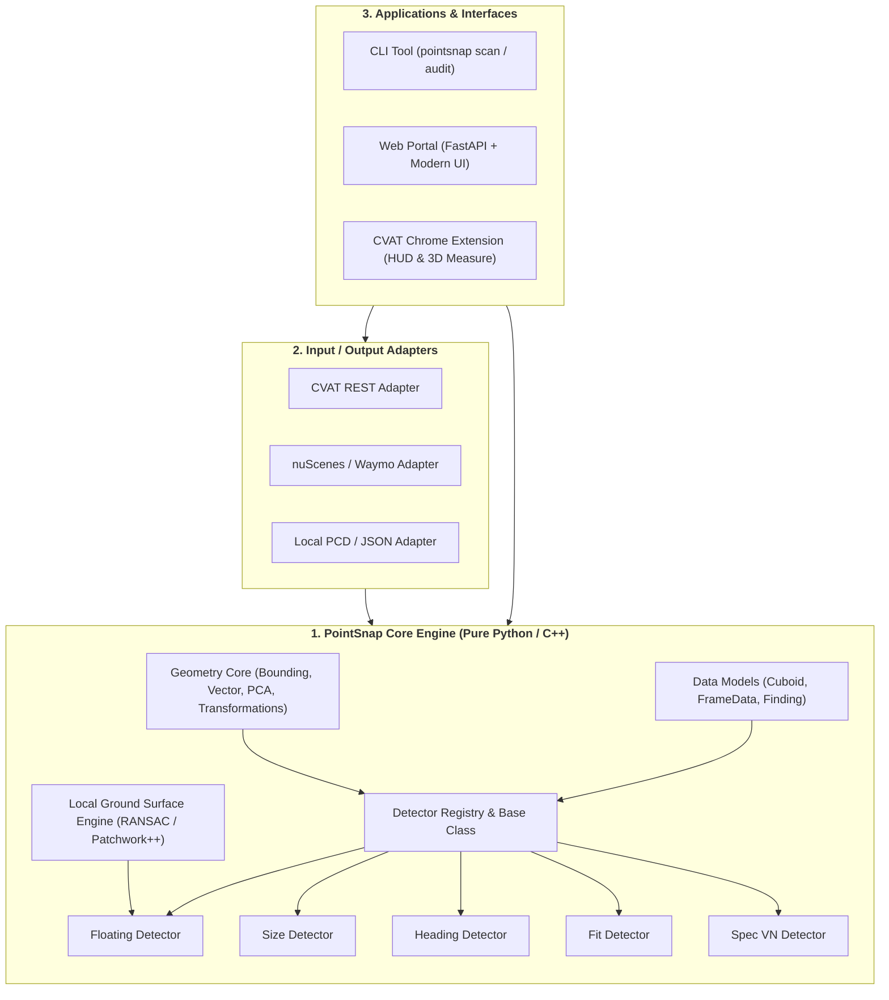

# PointSnap 3D — Pain Points, Bài Học Thực Chiến & Bản Thiết Kế Tái Xây Dựng (Blueprint)

> **Tài liệu nền tảng cho việc Rebuild hệ thống PointSnap 3D hoàn hảo hơn**  
> *Dành cho Kỹ sư Thiết kế Hệ thống, Thuật toán Hình học 3D và Tích hợp Nền tảng Gán nhãn*

---

## 1. Bối cảnh & Tầm quan trọng của Chất lượng Nhãn 3D LiDAR

Trong hệ sinh thái phát triển xe tự hành (Autonomous Vehicles - AV), bài toán nhận thức không gian (Perception) phụ thuộc sống còn vào dữ liệu huấn luyện từ cảm biến **LiDAR** kết hợp đa **Camera**. 

Khác với bounding box 2D trên ảnh chỉ có tọa độ phẳng $(x, y, w, h)$, **3D Bounding Cuboid** là vật thể hình học 7 bậc tự do (7-DoF):
$$\mathbf{B} = (x, y, z, l, w, h, \psi)$$
Trong đó:
- $(x, y, z)$: Tọa độ tâm hình học trong không gian 3D thực (mét).
- $(l, w, h)$: Kích thước thực tế (chiều dài Length, chiều rộng Width, chiều cao Height).
- $\psi$ ($\text{yaw}$): Góc xoay hướng di chuyển quanh trục thẳng đứng $Z$.

### Tại sao nhãn 3D Cuboid cực kỳ nhạy cảm?
1. **Độ cao mặt đất ($z$ và $z_{\min} = z - h/2$):** Các mô hình phát hiện 3D (PointPillars, CenterPoint, VoxelNeXt, BEVFusion) dựa vào cao độ để suy đoán tiếp xúc mặt đường. Nếu đáy box bị "lơ lửng" (floating) 20–30 cm hoặc "lún" (submerged) vào lòng đường, mô hình sẽ học sai đặc trưng mặt đất, dẫn đến hiện tượng **phanh khẩn cấp vô cớ (phantom braking)** hoặc bỏ sót xe thật đang đi.
2. **Góc hướng ($\text{yaw}$ $\psi$):** Góc yaw quyết định việc dự đoán hướng chuyển động và quỹ đạo (Trajectory Prediction). Nếu box bị lật ngược $180^\circ$ (heading flip), xe tự hành sẽ dự báo đối phương lao thẳng vào mình trong khi thực tế xe đang chạy cùng chiều, gây ra các phản ứng lái tránh nguy hiểm.
3. **Kích thước khít $(l, w, h)$:** Bounding box thừa hoặc thiếu sẽ làm sai lệch kích thước vật thể, ảnh hưởng trực tiếp đến việc ước tính khoảng cách an toàn (Time-to-Collision - TTC).

---

## 2. Ba Pain Points Cốt Lõi Tạo Ra PointSnap 3D

Khi gán nhãn thủ công trên nền tảng **CVAT 3D**, đội ngũ phát hiện ba "nỗi đau" (pain points) thực tế được ghi nhận chi tiết trong nhật ký dự án:



### Pain Point 1 (P-010): Sự bất lực của mắt thường khi căn đáy box sát mặt đất (Z-Grounding)
- **Thực tế:** CVAT hiển thị point cloud dạng wireframe không phân tách mặt đất. Trên các đoạn đường dốc, mấp mô, hoặc cự ly xa ($>25\text{ m}$), chùm tia LiDAR quét mặt đường rất thưa thớt hoặc bị tán xạ.
- **Khó khăn thao tác:** Annotator phải liên tục xoay camera 3D quanh đối tượng và chuyển sang các góc chiếu trực giao (Side/Front View) phóng to cực đại để ước lượng xem đáy cuboid đã chạm đất hay chưa. Việc căn chỉnh thủ công trục $Z$ chiếm tới **35% – 40% tổng thời gian chỉnh một box**.
- **Hậu quả sai sót:** Căn chỉnh bằng mắt thường có độ dung sai lớn ($\pm 5 - 15\text{ cm}$). Khi Reviewer kiểm tra ở góc nhìn ngang, phát hiện hàng loạt box bị lỗi "floating" (bay trên không) hoặc "penetrating ground" (lún ngập dưới lòng đường). Đây là loại lỗi hình học phổ biến nhất, chiếm **~30% số ca reject/rework** giữa annotator và reviewer.

### Pain Point 2 (P-011): Chi phí sửa chữa muộn cực lớn do thiếu Pipeline Pre-Review Auto-QA
- **Thực tế:** Quy trình cũ phụ thuộc hoàn toàn vào việc Reviewer mở từng frame và kiểm tra thủ công bằng mắt trên CVAT. Trong khi đó, hầu hết các lỗi 3D nghiêm trọng đều tuân theo các quy tắc logic / hình học có thể quét tự động bằng code:
  - Cuboid lơ lửng / lún đất so với mặt đường lân cận.
  - Kích thước dị thường vi phạm dải vật lý của class (ví dụ xe con dài 9m, người cao 3m).
  - Góc xoay yaw bị đảo $180^\circ$ hoặc rung lắc đột ngột giữa các frame.
  - Box rỗng điểm LiDAR ($0$ điểm hoặc $<3$ điểm) nhưng không có ghi chú/tag ngoại lệ.
  - Thiếu thuộc tính bắt buộc (`occluded`, `truncated`, `activity`).
- **Hậu quả:** Reviewer mất trung bình **3–5 phút cho mỗi frame** để rà soát thủ công. Một job 100 frame ngốn 5–8 giờ làm việc. Việc phát hiện lỗi muộn ở khâu review thủ công gây lãng phí lớn: tỷ lệ trả job chiếm **25% – 35% tổng thời lượng dự án**, làm chậm toàn bộ tiến độ giao hàng.

### Pain Point 3 (P-012): Quá tải thị giác và bỏ sót lỗi trong cảnh đông đúc (Scene Clutter)
- **Thực tế:** Trong các cảnh giao thông phức tạp (ùn tắc, ngã tư), số lượng cuboid trên một frame rất lớn (từ 40 đến 80+ đối tượng). Mặc định CVAT hiển thị tất cả các bounding box dạng wireframe cùng lúc trên không gian 3D.
- **Hậu quả:** 
  - *Che khuất tầm nhìn:* Các box xe lớn phía trước che lấp hoàn toàn người đi bộ hoặc cọc tiêu nhỏ phía sau.
  - *Quá tải nhận thức & Bỏ sót:* Không có dấu hiệu phân biệt giữa box "đã kiểm tra" và box "chưa kiểm tra", dẫn đến tỷ lệ bỏ sót lỗi ở các box khuất lên tới **15% – 20%**.
  - *Kiểm tra trùng lặp:* Reviewer bấm đi bấm lại một box nhiều lần vì không nhớ mình đã duyệt qua nó chưa, lãng phí thêm **25% – 30% thời gian review**.

---

## 3. Phân Tích Cơ Chế Các Bộ Phát Hiện Hình Học (Geometric Detectors)

PointSnap 3D xây dựng các thuật toán hình học chạy cực nhanh (CPU, $<2$ giây/job 100 frame) để phát hiện sai phạm dựa trên toán học và thống kê:

| Detector | Cơ chế toán học / thuật toán | Tiêu chuẩn đánh giá |
| :--- | :--- | :--- |
| **Grounding (`floating`)** | **Local Ground RANSAC**: Cắt lát các điểm trong bán kính đáy box $R = \sqrt{l^2 + w^2}/2 + 1.5\text{ m}$. Dùng RANSAC tìm mặt phẳng tiếp xúc mặt đường $ax + by + cz + d = 0$. Tính khoảng cách có dấu từ đáy box tới mặt phẳng. So sánh với trung vị track. | Cảnh báo: $10 - 20\text{ cm}$<br/>Lỗi: $> 20\text{ cm}$<br/>Xử lý cả mặt đường nghiêng dốc. |
| **Size (`size.*`)** | **Taxonomy Bounds & In-Track Variance**: So sánh $(l, w, h)$ với khoảng min/max chuẩn của từng class (vd: `car` length $[3.2, 5.8]\text{ m}$). Đồng thời kiểm tra độ lệch kích thước so với median của toàn bộ các frame khác trong cùng track. | Cảnh báo: Lệch $> 15\%$ median<br/>Lỗi: Ngoài dải taxonomy của class. |
| **Heading Flip (`heading.flip`)** | **Delta Yaw vs Neighbors**: Tính khoảng cách góc ngắn nhất $\Delta \psi = \min(|\psi - \psi_{\text{ref}}|, 360^\circ - |\psi - \psi_{\text{ref}}|)$ so với các keyframe lân cận của track. | Cảnh báo: $\Delta \psi \ge 60^\circ$<br/>Lỗi: $\Delta \psi \approx 180^\circ \pm 30^\circ$ (lật đầu xe). |
| **Heading Motion (`heading.motion`)** | **Velocity Vector Alignment**: Tính vector vận tốc $\vec{v} = (\Delta x / \Delta t, \Delta y / \Delta t)$. So sánh góc của $\vec{v}$ với góc yaw $\psi$ của box. | Cảnh báo nếu xe chạy $> 2\text{ m/s}$ nhưng hướng mũi tên box ngược với hướng chạy. |
| **Fit Outside / Loose (`fit.*`)** | **LiDAR Hull Penetration & Tightness**: Chuyển điểm LiDAR về hệ tọa độ cục bộ của box $P_{\text{box}} = R^T (P - T)$. Đếm tỷ lệ điểm nằm ngoài giới hạn $[-l/2, l/2] \times [-w/2, w/2] \times [-h/2, h/2]$. Đo khoảng cách từ mặt nhìn thấy tới điểm biên. | Cảnh báo: $> 30\%$ điểm ngoài box hoặc box dư $> 50\text{ cm}$. |
| **Spec VN (`attr.*`, `spec.*`)** | **Rule-based Logic Constraints**: Kiểm tra ràng buộc đặc tả dự án: người ngồi trong xe không được gán box riêng (Spec 4.3B); người lái xe máy không được gán đè box người lên xe (Spec 4.3C); kiểm tra bắt buộc phải có thuộc tính. | Báo lỗi ngay lập tức nếu vi phạm spec. |

---

## 4. Những Bài Học Xương Máu (Lessons Learned & Failed Assumptions)

Quá trình phát triển và kiểm thử thực tế trên nuScenes đã chỉ ra 3 bài học mang tính bước ngoặt:

### ⚠️ Bài học 1: Tại sao KHÔNG NÊN bắt lỗi đứt gãy track bằng thuật toán hình học thuần túy?
*Đây là lý do toàn bộ detector track jump/split/swap đã bị gỡ bỏ.*

1. **Vấn đề Chuyển động Tự thân của Xe Ego (Ego-Motion):**
   - Trên CVAT, tọa độ box ở từng frame thường được lưu theo hệ tọa độ cảm biến LiDAR tại thời điểm đó (Sensor Frame).
   - Khi xe ego di chuyển (đặc biệt khi xe quay vòng, phanh gấp, xóc dốc), nếu hệ thống không có ma trận chuyển vị toàn cục chính xác $T_{\text{world} \leftarrow \text{lidar}}$, một chiếc xe đang đứng yên bên đường sẽ có tọa độ biến thiên hàng chục mét giữa hai frame liên tiếp.
   - Thuật toán hình học đơn giản đo khoảng cách $\Delta d$ sẽ ngộ nhận đây là "Tâm box nhảy vị trí" (`track.jump`) hoặc "Xe chạy 60 m/s" $\rightarrow$ **Gây ra hàng trăm cảnh báo rác (False Positives)**, làm annotator hoàn toàn mất niềm tin vào tool.
2. **Hành vi chuyển động phức tạp của đối tượng thực:**
   - Người đi bộ dừng lại rồi quay ngoắt $180^\circ$, xe rẽ chữ U, xe khuất sau cây rồi xuất hiện lại... Các hiện tượng này hoàn toàn bình thường trong giao thông, nhưng thuật toán hình học lại báo "Nghi đổi nhầm ID" (`track.id_swap`) hoặc "Dùng lại ID sau outside" (`track.reuse_id`).
3. **Kết luận kiến trúc:**
   - **Chẩn đoán đứt gãy track không phải bài toán hình học tĩnh!** Đó là bài toán Multi-Object Tracking (MOT) cần mô hình lọc Kalman Filter + Re-Identification (ReID) dựa trên visual feature + Ego-motion Compensation. Cố gắng bắt bằng vài dòng lệnh so sánh khoảng cách là một thiết kế tồi.

### ⚠️ Bài học 2: Bỏ tính năng Auto-Repair / Snapping (v1) chuyển sang Manual Assistance HUD (v2) (QĐ-010)
1. **Rủi ro sửa hỏng nhãn:** Dữ liệu LiDAR luôn có nhiễu (bụi đường, mặt nước, nhánh cây). Một thuật toán tự động snap đáy box xuống mặt đất hoặc xoay box theo điểm rất dễ tính sai lệch $5 - 10\text{ cm}$. Nếu tool tự động sửa vào cơ sở dữ liệu CVAT, annotator sẽ không nhận ra và nhãn bị hỏng ngầm.
2. **Xung đột phiên bản (OCC Conflict):** Khi code phía server tự động PATCH sửa nhãn lên CVAT trong lúc annotator đang mở giao diện web làm việc, sẽ xảy ra xung đột ETag 409, gây mất dữ liệu gán dở của con người.
3. **Triết lý sống còn ([QĐ-010](file:///d:/AIvin/P-029/so-quyet-dinh.md#qđ-010)):**  
   > **"Tool đề xuất, con người quyết định."**  
   Tool chỉ làm nhiệm vụ đo đạc chính xác, cung cấp đường gióng mặt đất, hiển thị HUD thước đo thời gian thực; annotator dùng kinh nghiệm và đôi mắt chuyên môn để thực hiện nắn chỉnh tay và bấm Save nguyên bản trên CVAT.

### ⚠️ Bài học 3: Tích hợp với CVAT — Độ trễ và Rào cản Trình duyệt
- CVAT không hỗ trợ WebSocket hai chiều mặc định cho extension ngoài. Do đó, cần cơ chế đồng bộ nhẹ thông qua polling phiên bản (`reviews_rev`, `history_rev`) và bảo vệ chống ghi đè bằng ETag SHA-256.
- Extension MV3 cần giữ logic nhẹ, không can thiệp sâu vào Redux store của CVAT để tránh crash khi CVAT nâng cấp phiên bản.

---

## 5. Bản Thiết Kế Tái Xây Dựng (Blueprint for Perfect Rebuild)

Dựa trên những kinh nghiệm trên, phiên bản xây dựng lại hoàn hảo nên tuân theo mô hình **Clean Architecture & Headless Core**:



### Các nguyên tắc vàng khi thiết kế lại:

#### 1. Core Engine thuần khiết, độc lập (Headless & Zero-Coupling)
- Module Core (`pointsnap.core`) không được phụ thuộc vào FastAPI, HTTP client hay bất kỳ cấu trúc riêng nào của CVAT.
- Input của Core chỉ là: `list[Cuboid]`, `PointCloud (N x 3)`, và `GuidelineConfig`.
- Output chỉ là: `list[Finding]` với đầy đủ số đo thực tế, ngưỡng cho phép và gợi ý sửa.
- Nhờ vậy, Core có thể chạy ở mọi nơi: nhúng vào Extension qua WebAssembly, chạy trong script tiền kiểm tra CI/CD, chạy trong container server, hoặc chạy local CLI.

#### 2. Vectorization & Tối ưu hiệu năng
- Tuyệt đối tránh lặp `for point in points` bằng Python thuần. Sử dụng `numpy` vectorization, `scipy.spatial.cKDTree` cho tìm kiếm láng giềng gần nhất, hoặc thư viện C++ qua pybind11/Numba.
- Bộ nhớ đệm Ground Cache: Tính mặt phẳng đất một lần theo dạng lưới voxel/octree cho toàn frame, không tính lại RANSAC cho từng box nếu chúng nằm gần nhau.

#### 3. Plugin Architecture cho Detectors
- Mỗi detector là một class độc lập kế thừa `BaseDetector`:
  ```python
  class BaseDetector(ABC):
      @abstractmethod
      def detect(self, context: DetectionContext) -> list[Finding]:
          pass
  ```
- Thêm luật mới chỉ cần khai báo decorator `@register_detector("ten_luat")` mà không phải sửa scanner trung tâm.

#### 4. Tách biệt rõ 2 tầng phân tích: Fast Geometry vs Deep Vision
- **Tầng 1 - Fast Geometry (Thời gian thực, $<100\text{ ms}/frame$):** Chạy trên CPU, kiểm tra mặt đất, kích thước, góc quay, độ khít điểm. Đủ nhanh để hiển thị tức thì trên HUD của annotator khi vừa vẽ xong box.
- **Tầng 2 - Deep AI Audit (Bất đồng bộ, chạy nền trên GPU):** Gọi các model thị giác (Segment Anything, Grounding DINO, Box Critic) để đối chiếu ảnh camera 2D, phát hiện sót vật thể hoặc sai class. Kết quả trả về sau và gắn cờ nhẹ nhàng.

---

*Tài liệu được biên soạn dựa trên thực tế dự án PointSnap 3D (Tháng 10/2026).*