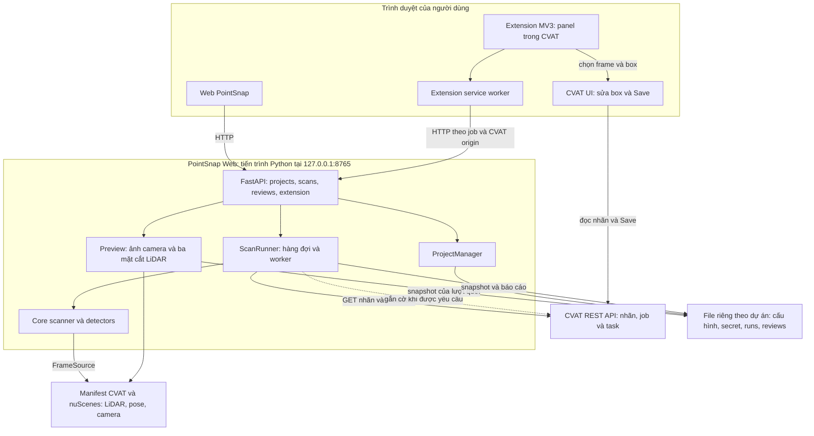
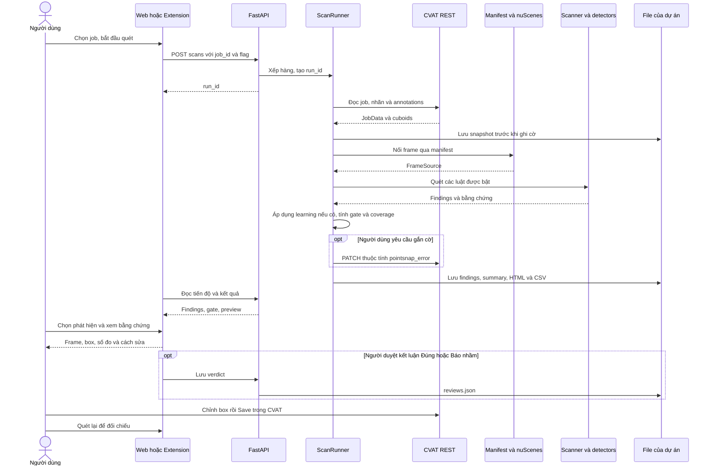
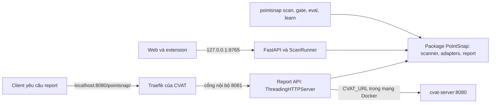

# Kiến trúc PointSnap 3D

Đối chiếu mã nguồn tại `main` **7ec580a**, ngày 14/10/2026. Sơ đồ mô tả các thành phần thực tế; các tiến trình có thể chạy từ những bản build khác nhau. Kết quả kiểm tra giao diện và phiên bản đã chạy nằm trong [review Web và extension](../../../review/2026-10-14/architecture-ux-review.md).

## Cấu trúc hệ thống

Web phục vụ cấu hình dự án và duyệt toàn bộ kết quả. Extension đưa phát hiện và cách sửa vào ngay CVAT, rồi chọn frame/box để người dùng chỉnh nhãn. Service worker gọi backend thay content script; phép quét và model chạy trong Python. Extension không tự suy luận model.

CVAT giữ annotation; PointSnap giữ cấu hình, snapshot và báo cáo trên filesystem. Manifest nối frame CVAT với dữ liệu nuScenes. Chỉ có annotation CVAT thì chưa đủ bằng chứng cho những luật cần LiDAR hoặc pose. Ảnh minh họa trong Web được chiếu từ cuboid và camera calibration; việc hiện ảnh không đồng nghĩa với đã chạy model thị giác.

`ScanRunner` dùng `ThreadPoolExecutor`, mặc định một worker và tối đa 16 tác vụ đang chạy/chờ. Đây là hàng đợi trong tiến trình; trạng thái được ghi vào file, chưa phải hệ thống worker phân tán. Core vẫn nhập `JobData` từ adapter CVAT nên chưa độc lập hoàn toàn với adapter.

### Cập nhật 15/10/2026: landing, `/app` và đồng bộ sửa box

- `GET /` phục vụ landing page của đội (`landing/`, offline: font ở `/static/fonts/`, Three.js trong `landing/vendor/`);
  ứng dụng web chuyển sang `GET /app`. Bản cài từ wheel không có `landing/` thì dùng trang dự phòng `static/landing.html`.
- Đồng bộ web ⟷ extension qua `ExtensionLink` trong bộ nhớ: `focus` (web chọn mục → CVAT chuyển frame),
  `reviews_rev` (kết luận Đúng / Báo nhầm), và mới: `history_rev` + `history_event` (lần áp dụng / hoàn tác sửa box mới
  nhất của job, kèm `history_id`). `apply-repair` và `rollback` tăng `history_rev`; `/api/extension/status` (web) và
  `/api/extension/poll` (extension) trả về để bên kia cập nhật nút Hoàn tác và trạng thái box không cần F5.
- Extension lấy đề xuất sửa qua `/api/projects/{slug}/scans/{run}/findings/{i}/repair` (cùng bằng chứng với web) khi cờ
  khớp một mục của lần quét; service worker chỉ cho đọc mục thuộc đúng job và CVAT đang mở.

## Luồng quét và duyệt

Gắn cờ chỉ ghi thuộc tính phát hiện; người dùng sửa hình học và lưu trong CVAT. Mục Lỗi/Cảnh báo có thể được gắn cờ; Thông tin không được gắn cờ. Gate dùng số lượng phát hiện và tình trạng thiếu bằng chứng, không chứng nhận precision của detector. Đánh giá đúng/sai vẫn cần verdict tay theo từng luật; proxy finding/100 box phải báo riêng.

## Các cách chạy

`pointsnap.api` là Report API riêng, dùng `ThreadingHTTPServer`; nó không phải FastAPI Web và không phải địa chỉ backend mặc định của extension. Compose gắn route `/pointsnap/` qua Traefik đến cổng nội bộ 8081, mount dữ liệu chỉ đọc và nhận PAT từ caller. Sơ đồ này thể hiện cấu hình trong repo; phép kiểm tra UX lần này dùng Web local, không nghiệm thu lại deployment Docker.

## Detector và model

| Thành phần | Vai trò | Điều kiện sử dụng |
|---|---|---|
| Luật hình học và track | Lơ lửng/lún, fit, heading, size, track, thuộc tính, missing | Guideline bật luật và có bằng chứng phù hợp |
| Camera verifier | Bằng chứng từ ảnh | `camera.enabled` cùng môi trường vision; chọn Mask R-CNN, hybrid hoặc Grounding DINO + SAM 2.1 |
| Box Critic | Model TorchScript để đánh giá box | Có đường dẫn `critic.model` và PyTorch |
| Learning theo reviewer | Thống kê Beta theo luật; logistic khi đủ dữ liệu | Logistic cần ít nhất 40 verdict, cả hai loại và ít nhất hai nhóm nguồn; kiểm chéo tốt hơn baseline theo luật |

Learning có thể xếp độ tin cậy cho phát hiện; hạ mức Cảnh báo chỉ khi bật `learning.adjust_severity` và đủ verdict theo luật. Nó không thay thế nghiệm thu bằng chấm tay. Trong lượt UX được báo cáo, camera inference bị tắt, Critic chưa cấu hình và chưa có learned model.

## Truy vết mã nguồn

| Thành phần | Nguồn |
|---|---|
| Web routes, phạm vi extension | [app.py](../pointsnap/web/app.py), [security.py](../pointsnap/web/security.py) |
| Dự án, token, lưu file | [projects.py](../pointsnap/web/projects.py), [storage.py](../pointsnap/web/storage.py) |
| Hàng đợi, snapshot, report | [runner.py](../pointsnap/web/runner.py) |
| Scanner và cấu hình luật | [scanner.py](../pointsnap/core/scanner.py), [config.yaml](../pointsnap/config.yaml) |
| Frame mapping | [common.py](../pointsnap/cli/common.py), [nuscenes adapter](../pointsnap/adapters/nuscenes/) |
| Đọc và gắn cờ CVAT | [CVAT adapter](../pointsnap/adapters/cvat/) |
| Camera preview và verdict | [preview.py](../pointsnap/web/preview.py) |
| Learning | [learn.py](../pointsnap/learn.py) |
| Extension | [manifest](../extension/manifest.json), [background.js](../extension/background.js), [content.js](../extension/src/content.js) |
| Report API và Docker route | [api.py](../pointsnap/api.py), [compose.yaml](../compose.yaml), [Dockerfile.api](../Dockerfile.api) |
