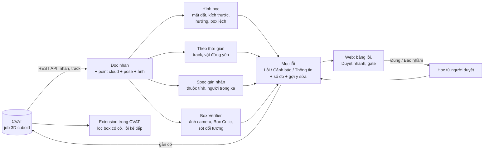

# PointSnap 3D — Báo cáo dự án

> Đối chiếu 13/10: số liệu dưới đây là snapshot 12/10, không đại diện mặc nhiên cho mã mới. Các scene kiểm tra đã được dùng chấm tay/chỉnh evidence nên không còn là held-out độc lập. Xem [kết quả bàn giao hiện hành](../../../review/2026-10-13/handoff-final-report.md); G7 dùng precision tay từng luật và còn chưa nghiệm thu khi thiếu mẫu. Proxy finding trên nhãn chuẩn không phải số báo nhầm đã xác nhận.

**Công cụ phát hiện và cảnh báo sớm lỗi nhãn 3D cuboid trên CVAT** · Đội P-029, Cohort 4A · Cập nhật 12/10/2026

> **Tóm tắt.** Gán nhãn 3D trên CVAT mất nhiều thời gian nhất ở vòng *nộp → bị trả về → sửa → nộp lại*. PointSnap đọc
> job qua API của CVAT, đối chiếu từng box với point cloud LiDAR, các frame khác của track, ảnh camera và spec gán nhãn,
> rồi **gắn cờ thẳng lên box lỗi** để annotator sửa trước khi nộp. Tool chỉ cảnh báo, **không tự sửa box**.
>
> Trên 5 cảnh nuScenes để kiểm tra (5 440 box, chưa từng dùng để chỉnh): bắt **100%** lỗi sai class / sai kích thước rõ,
> nhảy vị trí ≥ 2 m, lơ lửng / lún 20 – 40 cm (khi có điểm mặt đất); **93%** box lật / xoay ≥ 60°; lỗi lớn báo đúng mức
> **Lỗi 30/30**. Báo nhầm trên nhãn sạch **2,98 Cảnh báo / 0,59 Lỗi** trên 100 box — đạt mục tiêu trên cảnh tinh chỉnh
> (1,45 / 0,31), **chưa đạt** trên cảnh kiểm tra (mục tiêu ≤ 2 / ≤ 0,5), phần lớn do lơ lửng / lún. Quét một cảnh ~40
> keyframe mất 7 – 29 giây.

**Mục lục** — [1. Vấn đề](#1-vấn-đề) · [2. Giải pháp](#2-giải-pháp) · [3. Thuật toán](#3-thuật-toán) ·
[4. Kết quả](#4-kết-quả) · [5. Giới hạn](#5-giới-hạn) · [6. Hướng phát triển](#6-hướng-phát-triển) ·
[7. Tài liệu liên quan](#7-tài-liệu-liên-quan)

---

## 1. Vấn đề

Đội gán nhãn 3D cuboid (point cloud LiDAR) trên CVAT. Quan sát nội bộ của đội trong các tuần gán nhãn
([P-010](../../../problem-backlog.md#p-010), [P-011](../../../problem-backlog.md#p-011)):

| Lỗi | Vì sao khó thấy | Tác động |
|---|---|---|
| **Lơ lửng / lún** — đáy box không chạm mặt đường | CVAT không có mặt đất tham chiếu; phải xoay, zoom để căn bằng mắt | Chỉnh trục Z chiếm ~35 – 40% thời gian chỉnh một box; ~30% ca bị trả về |
| **Sai kích thước** — quá to / nhỏ so với loại xe, mỗi frame một cỡ | Reviewer phải so bằng mắt qua nhiều frame | |
| **Đứt track** — nhảy vị trí, tách một vật thành hai ID | Chỉ thấy khi tua cả đoạn | |
| **Sai hướng, box lệch, sót vật, sai spec** (giai đoạn 3) | Spec gán nhãn VN có hàng chục điều khoản | |

Reviewer mất **3 – 5 phút mỗi frame** để soi; rework chiếm **25 – 35%** thời lượng của đội.

## 2. Giải pháp

**Nguyên tắc** (theo góp ý của mentor 05/10): *tool đề xuất, con người quyết định*. PointSnap chỉ ghi một thuộc tính cờ
`pointsnap_error` lên box; không đổi vị trí, kích thước, class và không tạo box. Mỗi luật có **định nghĩa bằng số** và
ngưỡng ghi trong guideline, kiểm được bằng lỗi chèn giả.

Ba cách dùng, cùng một bộ luật:

| Cách | Dùng khi | |
|---|---|---|
| **Giao diện web** (`pointsnap ui`) | Hằng ngày: chọn job, quét, xem lỗi, duyệt nhanh, gắn cờ, cổng kiểm tra |  |
| **Extension cho CVAT** (Chrome / Edge) | Đang sửa trong CVAT: tự lọc box có cờ, phím `.` / `,` nhảy tới lỗi kế tiếp, rê chuột xem lỗi và gợi ý sửa |  |
| **Dòng lệnh** (`pointsnap scan / gate`) | CI, script, cổng kiểm tra trước khi nộp (mã thoát 0 / 1) | |

**Ba mức:** *Lỗi* (chắc chắn sai, phải sửa trước khi nộp) · *Cảnh báo* (nhiều khả năng sai, cần xem) · *Thông tin*
(không đủ bằng chứng để kết luận, ví dụ không có điểm mặt đất quanh box — tool nói rõ là không kiểm được thay vì đoán).

## 3. Thuật toán

Mọi hình dưới đây vẽ từ **dữ liệu nuScenes thật** (scene-0061) bằng chính code của PointSnap
([`scripts/ve_hinh_minh_hoa.py`](../scripts/ve_hinh_minh_hoa.py)).

### 3.1. Lơ lửng / lún — mặt đất cục bộ quanh box

1. Lấy điểm LiDAR trong **vành đai 0,1 – 0,8 m quanh đáy box** (nhìn từ trên: dải xanh), bỏ điểm thuộc box khác.
2. Lọc lưới min-Z (mỗi ô 0,4 m chỉ giữ điểm thấp) để bỏ chân xe, cột, bụi cây → **mặt đất = trung vị** độ cao các điểm còn
   lại.
3. `d = đáy box − mặt đất`. Nhãn chuẩn nuScenes tự nó đã lệch mặt đất ước lượng vài cm (bờ vỉa, LiDAR thưa) nhưng **lệch
   đều trong một track**, nên luật so `d` của box với **trung vị `d` các frame khác của track**: lệch > 15 cm → Cảnh báo,
   > 22 cm → Lỗi. Box lẻ (không có track để so) dùng ngưỡng tuyệt đối 15 / 30 cm.
4. **Mặt đất v2:** gộp thêm 4 lượt quét LiDAR trung gian trước mỗi keyframe (bỏ vệt của xe đang chạy theo vị trí box nội
   suy), để vành đai có nhiều điểm hơn.
5. Không đủ điểm mặt đất → mục *Thông tin* "thiếu bằng chứng" (không đoán).

**Mặt đường dốc (C4).** Box 7-DoF không có pitch / roll, nên trên dốc box đúng spec chạm đường ở **góc thấp nhất**; trung
vị vành đai lệch `tan(dốc) × nửa chiều dài` (dốc 8°, xe 4,5 m → 32 cm) và báo nhầm "lún". Khi vành đai khớp rõ một mặt
phẳng dốc ≥ 5°, luật so với **điểm tiếp xúc thấp nhất** trên mặt phẳng đó.

### 3.2. Sai kích thước

- **Theo class:** dài / rộng / cao so với khoảng thường gặp của class thống kê trên 5 cảnh tinh chỉnh (khoảng của xe buýt,
  xe ba gác, động vật… đặt tay); ra ngoài khoảng nới 10% → Cảnh báo, nới 25% → Lỗi. Với bộ class spec-vn, khoảng tra theo **class + thuộc tính** (`Vehicle/van`,
  `Pedestrian/child`…). Bắt cả **gán nhầm class** (box xe con gán class xe buýt).
- **Trong track:** một vật cứng không đổi kích thước — lệch so với trung vị track > max(10 cm, 5%) → Cảnh báo,
  > max(30 cm, 15%) → Lỗi. Không áp cho người đi bộ (tư thế thay đổi).

### 3.3. Đứt track

- **Nhảy vị trí:** đổi tâm box sang **hệ toàn cục** bằng pose xe thu (bù chuyển động của xe thu), nội suy vị trí từ hai
  keyframe bên cạnh; lệch quá ngưỡng theo nhóm vật (xe: 1 m Cảnh báo / 2 m Lỗi). Hai đầu track dùng ngoại suy; vật đứng
  yên có ngưỡng riêng. Chỉ báo frame lệch nhất trong một cụm.
- **Tách ID:** một track kết thúc và track cùng class bắt đầu ngay gần đó, khớp vận tốc.
- **Đổi nhầm ID** (`track.id_swap`, spec 4.4.6): hai track cùng nhóm đổi chỗ nhau ở một frame.
- **Spec 4.4:** dùng lại track sau `outside`, che khuất (`occluded`) quá 6 frame, khoảng nội suy dài không có keyframe.

### 3.4. Sai hướng box

- `heading.flip`: hướng đổi đột ngột giữa hai keyframe (lật 180°, xoay 90°).
- `heading.motion`: mũi tên hướng box ngược hướng vật đang chạy (bỏ qua khi xe chạy chậm — có thể đang lùi).
- `heading.points`: trục box lệch trục của cụm điểm LiDAR. Nhìn từ trên, điểm của xe nằm sát hai cạnh nhìn thấy (hình chữ
  L); thử từng góc, góc mà nhiều điểm sát cạnh hình chữ nhật nhất là trục của vật. So modulo 90°.

### 3.5. Box lệch khỏi vật

Spec 4.2: box bao trọn vật, không dư quá mức. `fit.outside` — nhiều điểm của vật nằm ngoài box (so với các frame khác của
track); `fit.loose` — mặt box nhìn thấy rõ mà cách xa điểm gần nhất; `fit.empty` — box không có điểm nào; `fit.overlap` —
hai box chồng nhau (nghi vẽ trùng).

### 3.6. Sót đối tượng

`lidar.missing` (C7): mỗi keyframe bỏ mặt đất và điểm trong box đã gán, gom cụm trên lưới 0,25 m, giữ cụm **cỡ người / xe /
xe hai bánh** có chân sát đất; bỏ cụm mà 1 giây trước / sau chỗ đó vẫn còn điểm (tường, cây, cột). Nối cụm qua các keyframe
trong hệ toàn cục: chuỗi **di chuyển đều ≥ 3 keyframe, dời ≥ 3 m** → "nghi sót đối tượng", kèm tâm cụm từng frame để vẽ
box. Hình trên: xóa hết box của một xe đang chạy rồi quét — PointSnap tìm lại xe đó qua 10 keyframe. Vật **đứng yên** (C8)
không phân biệt được với cột / thùng rác bằng LiDAR, nên chỉ báo khi ảnh camera xác nhận cùng loại vật.

### 3.7. Bám spec gán nhãn VN

Bộ class **spec-vn** (5 class Vehicle / Two-wheels / Pedestrian / Animal / Obstacle, chi tiết ở thuộc tính) và các luật:
thiếu / sai thuộc tính (spec 3.1.3), thuộc tính không khớp chiều cao box (tư thế, nhóm tuổi), **người bên trong xe**
(spec 4.3B), **người lái gán hai lần** (4.3C), **quên đổi `rider_state`** khi lên / xuống xe (4.3C), vật quá ít điểm (4.2).
Bảng truy vết đầy đủ điều khoản ↔ luật: [đề xuất mục 4.7](thiet-ke/de-xuat-de-tai.md#47-bám-spec-gán-nhãn-giai-đoạn-3).

### 3.8. Box Verifier — thêm bằng chứng từ nhiều nguồn

| Lớp | Nguồn | Luật |
|---|---|---|
| 1 | **Vật đứng yên** trong hệ toàn cục: các keyframe phải trùng vị trí / hướng | `track.static_shift`, `heading.static` |
| 2 | **Ảnh camera**: chiếu box lên ảnh, so với vật model ảnh nhận ra (Mask R-CNN; tùy chọn Grounding DINO + SAM 2.1) | `cam.mismatch`, `cam.class`, `cam.missing` |
| 3 | **Box Critic** — PointNet nhỏ nhóm tự huấn luyện (ensemble 5 model), chấm box có sai không và gợi ý sửa | `critic.box` |
| 4 | **Học từ người duyệt** — kết luận Đúng / Báo nhầm chấm độ tin cậy cho lần quét sau | xếp hạng, hạ mức |

Model chỉ thêm bằng chứng mức Thông tin / Cảnh báo và tắt được trong guideline. Cách huấn luyện:
[hướng dẫn huấn luyện](huong-dan/huan-luyen-box-critic.md).

## 4. Kết quả

### 4.1. Cách đo

Không có bộ nhãn lỗi thật đủ lớn, nên đo bằng **lỗi chèn giả**: lấy nhãn chuẩn nuScenes v1.0-mini, chèn 11 kiểu lỗi ở
nhiều mức (lơ lửng / lún 5 – 40 cm, kích thước 5% – x1,5 hoặc sai class, nhảy 0,5 – 4 m, xoay 15 – 180°, dời / co box,
tách ID, nội suy dài, vẽ trùng…), quét,
rồi đếm lỗi được báo **đúng loại, đúng box**. 10 vòng chèn mỗi cảnh. Báo nhầm đo trên nhãn chuẩn **chưa chèn lỗi**.

10 cảnh chia cố định: **5 cảnh tinh chỉnh** để chọn ngưỡng, **5 cảnh kiểm tra** chỉ đo một lần cho bản cuối.

### 4.2. Kết quả trên 5 cảnh kiểm tra

| Chỉ số | Mục tiêu | Cảnh tinh chỉnh (8 664 box) | **Cảnh kiểm tra (5 440 box)** |
|---|---|---|---|
| Báo nhầm Cảnh báo / 100 box | ≤ 2 | 1,45 ✅ | **2,98** ❌ |
| Báo nhầm Lỗi / 100 box | ≤ 0,5 | 0,31 ✅ | **0,59** ❌ |
| Lỗi lớn báo đúng mức Lỗi | ≥ 80% | 90% (26/29) ✅ | **100% (30/30)** ✅ |
| Thời gian quét một cảnh (~40 keyframe) | < 2 phút | 8 – 29 s ✅ | **7 – 20 s** ✅ |

Đọc biểu đồ:

- **Bắt tốt (≥ 89%):** sai class, kích thước sai cả track hoặc một frame ≥ 15%, nhảy ≥ 2 m, tách ID, lật / xoay ≥ 60°,
  lơ lửng / lún 20 – 40 cm **khi box có điểm mặt đất quanh**.
- **Lơ lửng / lún trên mọi box chỉ 15%**: phần lớn box bị chèn lỗi nằm ở chỗ không có điểm mặt đất (xe đỗ sát nhau, xa
  LiDAR); tool ghi "thiếu bằng chứng" thay vì đoán. Đây là giới hạn của dữ liệu LiDAR, không phải của luật.
- **Bắt kém:** xoay nhỏ 15 – 30° (24%), dời box 0,3 – 1 m (35%), co / phóng box (5%) — các lỗi nhỏ lẫn vào nhiễu của nhãn
  chuẩn; Box Critic và lớp ảnh camera mới bắt thêm được một phần.
- **Báo nhầm:** gần 2/3 là lơ lửng / lún (1,54 Cảnh báo + 0,37 Lỗi trên 100 box) ở bờ vỉa, dốc, LiDAR thưa.

Số liệu đầy đủ từng mức chèn: [eval sau khi merge 12/10](ket-qua/eval/sau-merge-12-10/kiem-tra.md) ·
[cảnh tinh chỉnh](ket-qua/eval/sau-merge-12-10/tinh-chinh.md). Kết quả riêng từng phần:
[giai đoạn 3](ket-qua/ket-qua-giai-doan-3.md) · [Box Verifier](ket-qua/ket-qua-box-verifier.md) ·
[sót đối tượng](ket-qua/ket-qua-sot-doi-tuong.md) · [kiểm chứng mặt đất](ket-qua/kiem-chung-ground.md) ·
[extension](ket-qua/thu-extension.md).

### 4.3. Quá trình cải thiện

| Mốc | Báo nhầm cảnh kiểm tra (Cảnh báo / Lỗi) | Thay đổi chính |
|---|---|---|
| Giai đoạn 3 (PR #37) | 3,42 / 0,55 | Sai hướng, box lệch, mặt đất v2 |
| Box Verifier (PR #39), ngưỡng lơ lửng 12 cm | 3,67 / 0,57 | Thêm 4 lớp kiểm |
| Ngưỡng lơ lửng 15 cm, C5 – C8 | 2,88 / 0,57 | Sót đối tượng, tình huống thực tế, bám spec |
| **Sau khi merge 12/10** (PR #40 – #50) | **2,98 / 0,59** | `heading.points` từ 12° (bắt xoay 15° nhiều hơn), lơ lửng trên dốc, nhảy ở hai đầu track |

## 5. Giới hạn

- **Dữ liệu:** đánh giá trên nuScenes (Singapore / Boston); khoảng kích thước của van, xe ba gác, động vật là ước lượng.
  Chưa chạy trên dữ liệu và CVAT của BTC.
- **Lơ lửng / lún** cần điểm mặt đất quanh box; chỗ đông xe, xa LiDAR thì chỉ báo "thiếu bằng chứng". Track đi từ đường
  bằng lên dốc vẫn có thể bỏ sót box lơ lửng ở đoạn dốc.
- **Lỗi nhỏ** (dời < 0,5 m, xoay < 30°, co / phóng ≤ 30%) bắt được ít.
- **Sót đối tượng:** tìm lại 66 – 71% vật di chuyển bị bỏ box; người đi chậm trong nhóm, xe ở xa > 30 m còn sót; vật đứng
  yên chỉ báo khi ảnh camera ban ngày xác nhận.
- Box `occluded` không kiểm hình học, chỉ kiểm thời gian che theo spec.
- CVAT không khóa job khi có người mở: chỉ gắn cờ khi không ai đang sửa job đó.

## 6. Hướng phát triển

1. **Giảm báo nhầm lơ lửng / lún** trên cảnh kiểm tra (mục tiêu G7): xem tay các mục còn lại, xử lý bờ vỉa và LiDAR thưa.
2. **Dữ liệu thật:** chạy trên job đã gán của đội, thu kết luận Đúng / Báo nhầm (lớp 4) — vừa đo precision thật, vừa làm
   dữ liệu khó cho Box Critic.
3. **Box Critic mạnh hơn** với nuScenes trainval và dữ liệu Việt Nam ([hướng dẫn, mục 9](huong-dan/huan-luyen-box-critic.md#9-hướng-cải-tiến-theo-thứ-tự-nên-làm)).
4. **Gợi ý sửa → sửa một chạm có người duyệt**, rồi mới tự sửa khi độ tin cậy cao (lộ trình 4 bước,
   [đề xuất mục 11](thiet-ke/de-xuat-de-tai.md#11-hướng-phát-triển)).

## 7. Tài liệu liên quan

| Tài liệu | Nội dung |
|---|---|
| [README](../README.md) | Giới thiệu, cài nhanh, cách dùng |
| [CAI-DAT.md](../CAI-DAT.md) | Cài từ máy trắng: CVAT, nuScenes, PointSnap, extension |
| [Đề xuất đề tài](thiet-ke/de-xuat-de-tai.md) | Thiết kế chi tiết từng luật, ngưỡng, kế hoạch, rủi ro |
| [CONVENTIONS.md](../CONVENTIONS.md) | Hệ tọa độ, mã luật |
| [Hướng dẫn huấn luyện](huong-dan/huan-luyen-box-critic.md) | Box Critic, học từ người duyệt |
| [Quy trình phát triển](huong-dan/quy-trinh-phat-trien.md) | Chia dữ liệu, đo, thêm luật mới, checklist PR |
| [Bàn giao 12/10](../quan-ly/ban-giao-12-10.md) | Trạng thái, việc còn lại theo người |
