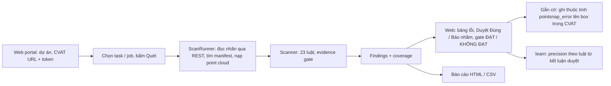
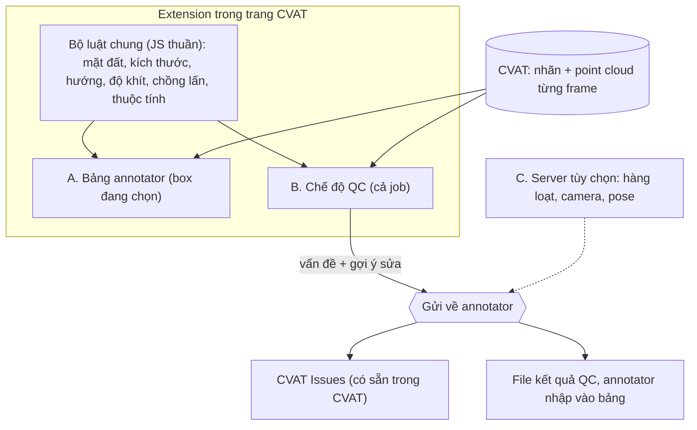

# Tool scan QC — phân tích hiện trạng và thiết kế lại

*Ngày 25/10/2026. Phân tích dựa trên mã trong `pointsnap/` (backend Python ~18 000 dòng) và kiểm tra trực tiếp trên CVAT
2.75.1 local. Tài liệu đi cùng: [pain point và giải pháp](pain-points-va-giai-phap.md) (phần annotator).*

## 1. Tóm tắt

- Tool QC hiện tại **chạy tốt trên dữ liệu demo nuScenes**, nhưng **chưa dùng được trên CVAT của công ty**. Có ba lý do:
  1. chỉ lấy được point cloud từ bản xuất nuScenes do chính tool tạo;
  2. gắn cờ lỗi cần một thuộc tính trong schema label, mà sửa schema thì phải có quyền sửa project;
  3. nhiều luật cần pose, camera hoặc GPU, những thứ một CVAT bình thường không có.
- Luật của QC và luật của extension annotator **đã lệch nhau** (mặt đất, khoảng kích thước, luật yaw, ngưỡng). Annotator thấy
  "ổn" mà QC báo lỗi, hoặc ngược lại, là cách nhanh nhất để cả hai bên mất tin tool.
- Hai điều **đã kiểm trên CVAT thật** mở ra hướng khác:
  - CVAT trả point cloud của job qua API (`/api/jobs/<id>/data?type=chunk`, zip các file `.pcd`), bằng tài khoản thường;
  - trong trình duyệt, extension đọc được point cloud của **frame bất kỳ** trong 1–2 ms.
- **Đề xuất:** làm **"chế độ QC" ngay trong extension**. QC mở job trên CVAT, bấm "Quét cả job"; extension chạy **cùng bộ luật**
  với annotator trên mọi box của mọi frame, ra danh sách vấn đề, bấm để nhảy tới box, ghi Đúng / Báo nhầm, xuất báo cáo.
  Cách này không cần server, không cần token, không cần quyền sửa schema, và dữ liệu không rời CVAT. Phần nặng (quét hàng
  loạt nhiều job, camera / ML, gộp nhiều frame theo pose) để ở tầng server tùy chọn, làm sau.

## 2. Hiện trạng: tool đang làm gì

### 2.1 Luồng

- Điểm vào: `pointsnap ui` (FastAPI, cổng 8765), `pointsnap scan / gate` (CLI, mã thoát cho CI).
- Lưu trữ: file JSON theo dự án trong `POINTSNAP_HOME`; hàng đợi là thread trong tiến trình, không bền.
- Tốc độ đã đo: 7–20 s một cảnh khoảng 40 keyframe.

### 2.2 Các luật (`pointsnap/config.yaml`, `core/scanner.py`)

| Nhóm | Luật | Cần |
|---|---|---|
| Mặt đất | `floating` (RANSAC vành đai quanh box, so với trung vị track, gộp 4 sweep) | Point cloud |
| Kích thước | `size.class_range`, `size.in_track` | Chỉ box |
| Hướng | `heading.flip`; `heading.motion`, `heading.static` | Box; hai luật sau cần pose |
| Độ khít | `heading.points`, `fit.empty`, `fit.outside`, `fit.loose`, `fit.overlap`, `fit.offset/yaw` (SAM) | Point cloud (SAM: GPU) |
| Spec / thuộc tính | `attr.missing/invalid/height`, `spec.inside`, `spec.rider_double`, `attr.rider_state` | Box; `rider_state` cần pose |
| Sót vật | `lidar.missing` (cụm điểm chuyển động không có box) | Point cloud + pose |
| Camera / ML | `cam.mismatch/class/missing/sparse`, `cam.face` (CLIP), `critic.box` (PyTorch) | Ảnh + calibration + model |

Kèm theo: evidence gate (hạ mức khi box ít điểm), coverage (ghi rõ luật nào không chạy vì thiếu dữ liệu), learn
(Beta / logistic theo kết luận duyệt), và nhánh sửa tự động v1 (route trả HTTP 410, bỏ từ QĐ-010).

## 3. Vấn đề khi đem dùng thật

| # | Vấn đề | Bằng chứng | Hậu quả |
|---|---|---|---|
| Q1 | **Point cloud chỉ lấy từ bản xuất nuScenes** của tool (`ManifestFrames` đọc `manifest.json` + thư mục nuScenes gốc) | `cli/common.py: frames_for_job`, `adapters/cvat/reader.py: ManifestFrames` | Trên CVAT công ty, mọi luật cần LiDAR bị bỏ qua: mặt đất, độ khít, `heading.points`, `lidar.missing`. Chỉ còn luật kích thước, hướng, thuộc tính |
| Q2 | **Gắn cờ ghi vào thuộc tính `pointsnap_error`**, chỉ có khi task được tạo bằng `to-cvat` | `adapters/cvat/writer.py`, `datasets/nuscenes/to_cvat.py: label_specs` | Trên project có sẵn phải thêm thuộc tính vào schema label (cần quyền sửa project). Ghi qua PATCH vào nhãn của annotator, nên dễ xung đột khi họ đang mở job |
| Q3 | **Pose**: CVAT không lưu pose xe thu | `scan_coverage_gaps` | `heading.motion`, `heading.static`, `attr.rider_state`, `lidar.missing` chạy một phần hoặc không chạy |
| Q4 | **Luật QC lệch luật annotator** | So `config.yaml` với `extension/src/annotator/guideline.js` | Hai nơi ra kết luận khác nhau trên cùng một box (chi tiết ở 3.1) |
| Q5 | **Camera / ML** cần calibration, model, GPU; mặc định nhiều luật đang bật | `config.yaml` (`cam_*: true`, `critic_box: true`) | Trên CVAT thường, báo cáo luôn kèm "kiểm tra một phần", gây khó hiểu |
| Q6 | **Annotator phải đổi ứng dụng** để xem lỗi (web portal); cờ là chuỗi chữ trong thuộc tính, không bấm để nhảy tới được | `web/static`, writer | Vòng QC → annotator chậm, dễ bỏ sót |
| Q7 | **Hiệu năng và mã**: mỗi luật đọc lại PCD; hai kiến trúc detector song song; ~500 dòng sửa tự động v1 chết; `web/app.py` 1 200 dòng | Ghi chú rà soát 24/10 | Khó sửa, khó mở rộng |
| Q8 | **Precision chưa nghiệm thu trên dữ liệu thật của đội** | `docs/bao-cao-du-an.md` | Chưa biết bao nhiêu % báo là đúng |

### 3.1 Chỗ lệch giữa QC và annotator (Q4)

| Mục | QC (`config.yaml`) | Annotator (extension 0.5.0) | Dữ liệu chọn bên nào |
|---|---|---|---|
| Mặt đất | RANSAC vành đai 0,1–0,8 m quanh footprint, so với trung vị track | Bản đồ địa hình cả frame (GroundGrid), dải ±1 m, khoảng [thấp, cao] dưới 4 góc, ≤ 50 m | Extension: đo trên AV2 có bản đồ thật, p90 ≤ 10 cm trong 50 m |
| Ngưỡng lơ lửng / lún | 15 / 22 cm | 20 / 35 cm | Extension: chỉnh trên nhãn chuẩn nuScenes |
| Khoảng kích thước | 5 cảnh nuScenes | 10 cảnh, nới người / xe máy / nón / bus | Extension: báo nhầm 3,4% → 0,5% |
| Hướng nhảy | So lân cận | Đoán từ lân cận (nội suy + ngoại suy) | Extension: 0,02% báo nhầm, bắt 98% lật 180°, cả ở hai đầu track |
| Độ khít | Tỉ lệ điểm ngoài box so với trung vị track | Mặt lòi > 10 cm hoặc ≥ 20 điểm đỏ chiếm ≥ 15% | Chưa so trực tiếp |

## 4. QC thật sự cần gì (khác annotator ở đâu)

| | Annotator | QC |
|---|---|---|
| Đơn vị | Một box, ngay lúc đang sửa | Cả job (hàng chục track, hàng trăm đến hàng nghìn box) |
| Câu hỏi | "Box này đúng chưa, sửa thế nào?" | "Job này đạt chưa? Xem box nào trước? Lỗi nào trả về annotator?" |
| Cần thêm | Số đo, nút sửa | Danh sách xếp hạng, lọc theo luật / track / frame, kết luận Đúng / Báo nhầm, gate, báo cáo, gửi lỗi về annotator |
| Luật chỉ QC làm được | — | Cấp job: box trùng giữa hai track, sót vật (`lidar.missing`), thống kê lỗi theo annotator / luật |

Nguyên tắc giữ nguyên: **tool đề xuất, người quyết** (QĐ-010). QC không tự sửa nhãn; chỉ gửi vấn đề về annotator.

## 5. Thiết kế đề xuất

### 5.1 Nguyên tắc

1. **Một bộ luật cho cả annotator và QC.** Các module JS trong `extension/src/annotator/` (`box`, `terrain`, `checks`,
   `object-points`, `track-ops`, `guideline`) là hàm thuần, đã có test Node, nên dùng lại nguyên cho QC.
2. **Dữ liệu lấy từ chính CVAT**, không từ bản xuất riêng.
3. **Không cần quyền đặc biệt**: không sửa schema, không token cho luồng chính.
4. **Rõ phần nào không kiểm được** (coverage), không im lặng bỏ qua.

### 5.2 Ba tầng

| Tầng | Chạy ở đâu | Làm gì | Cần |
|---|---|---|---|
| **A. Annotator** (đã có, 0.5.0) | Extension, box đang chọn | Kiểm tra trực tiếp + nút sửa | — |
| **B. QC trong extension** (đề xuất làm trước) | Extension, cả job, trong tab CVAT của QC | Quét mọi box mọi frame bằng cùng luật; luật cấp job; danh sách, nhảy tới box, Đúng / Báo nhầm, gate, xuất báo cáo; gửi vấn đề về annotator | Tài khoản CVAT mở được job |
| **C. Server cạnh CVAT** (tùy chọn, sau) | Máy chủ trong mạng CVAT | Quét hàng loạt nhiều job theo lịch; camera / ML; gộp nhiều frame theo pose; mặt đất ở xa | Token, pose, GPU; cần mentor chốt có được coi là "dữ liệu không rời CVAT" |

### 5.3 Chế độ QC trong extension (tầng B)

**Luồng của QC:**
1. Mở job trên CVAT → bảng PointSnap → **Quét cả job**.
2. Extension đọc nhãn mọi frame (`job.annotations.get`) và point cloud mọi frame (`job.frames.get(n).data()`, đã kiểm), rồi
   chạy bộ luật chung trên từng box và các luật cấp job trên cả job.
   - Ước lượng tốc độ từ số đo AV2: dựng bản đồ mặt đất 30–90 ms mỗi frame, đo một box ≤ 8 ms. Khoảng 5–10 s cho 40 frame,
     1–2 phút cho 1 000 frame; có thanh tiến độ, dừng được.
3. **Bảng QC**:
   - gate ĐẠT / KHÔNG ĐẠT theo ngưỡng dự án;
   - số vấn đề trên 100 box theo luật;
   - danh sách gộp theo track (một track lệch kích thước 30 keyframe là một mục, không phải 30 mục), lọc theo luật / mức /
     class.
4. Bấm một mục → CVAT nhảy tới frame và chọn đúng box; bảng annotator hiện số đo của box đó.
5. QC ghi **Đúng / Báo nhầm** cho từng mục. Kết luận lưu theo job trong trình duyệt và xuất được ra file, dùng để đo
   precision từng luật (nối với `learn` sau này).
6. **Xuất**: CSV / JSON kết quả và báo cáo tóm tắt.

**Luật cấp job cần thêm** (chỉ QC làm, vì cần nhìn cả job):
- box trùng giữa hai track khác nhau (chồng > 50% nhiều frame liền);
- track có keyframe "rơi" giữa chừng (outside xen kẽ bất thường);
- chặn đáy bằng điểm của chính vật cho box ở xa (đã đo trên AV2: 50–100 m bắt 52–78% box lơ lửng 0,5–1 m, báo nhầm 1,6%);
- `lidar.missing` (sót vật): chuyển dần từ Python sang sau, vì cần pose mới chính xác.

### 5.4 Gửi vấn đề về annotator

| Cách | Ưu | Nhược | Trạng thái |
|---|---|---|---|
| **CVAT Issues** (tính năng review có sẵn) | Có sẵn trong CVAT; annotator thấy trong giao diện quen; không sửa schema | Chưa biết giao diện job 3D có hiện issue không | API `/api/issues` trả 200 trên CVAT local; **chưa thử tạo issue cho job 3D** |
| **File kết quả QC** → annotator nhập vào bảng PointSnap | Không phụ thuộc CVAT; hiện ngay trên checklist và dải track ("QC báo"), có nút sửa | Phải chuyển file (chat, ổ chung) | Cần làm |
| Cờ `pointsnap_error` (cách hiện tại) | Đã có, có bảo vệ hình học | Cần sửa schema; ghi vào nhãn | Giữ cho project đã có thuộc tính này |

Đề xuất: thử CVAT Issues trên job 3D trước. Nếu hiện được thì dùng làm kênh chính, còn file là phương án dự phòng.

### 5.5 Backend Python hiện tại

- **Giữ**: đánh giá / benchmark trên nuScenes (`eval`), học từ kết luận (`learn`), các luật camera / ML. Đây là nguyên liệu
  cho tầng C.
- **Sửa** khi tầng C được làm: thêm `CvatFrames` đọc point cloud từ CVAT (`/api/jobs/<id>/data?type=chunk`) thay cho
  `ManifestFrames`; đọc mỗi frame một lần; bỏ nhánh sửa tự động v1; chọn một kiến trúc detector.
- **Không** tiếp tục chỉnh ngưỡng song song ở `config.yaml`: ngưỡng và luật chung lấy từ một nguồn (guideline của extension),
  để tránh lệch như mục 3.1.

## 6. Lộ trình

| Giai đoạn | Việc | Công sức | Xong khi |
|---|---|---|---|
| 1 | Chế độ QC trong extension: quét cả job, danh sách gộp theo track, nhảy tới box, Đúng / Báo nhầm, gate, xuất CSV / JSON | Vừa (khoảng 1–2 tuần) | Quét được job 3D bất kỳ trên CVAT local và một CVAT khác, không cần server |
| 2 | Gửi về annotator: thử CVAT Issues trên job 3D; nếu không được thì làm nhập file QC vào bảng annotator | Nhỏ đến vừa | Annotator thấy vấn đề QC ngay trong CVAT, bấm tới box |
| 3 | Luật cấp job (box trùng giữa track, chặn đáy ở xa), đo precision thật trên job của đội | Vừa | Có precision theo luật trên dữ liệu thật |
| 4 | Tầng C (tùy chọn): server cạnh CVAT, `CvatFrames`, quét hàng loạt, camera / pose | Lớn | Chỉ làm nếu mentor xác nhận cần và được phép |

## 7. Câu hỏi cần chốt với mentor

1. **QC hiện làm thế nào?** Xem 100% job hay lấy mẫu? Một người QC một job mất bao lâu? Lỗi hay bị trả về nhất là loại gì?
2. **Gửi lỗi về annotator bằng gì?** Đang dùng CVAT Issues, bảng tính, hay chat? Kênh nào annotator sẽ thật sự đọc?
3. **Tiêu chí ĐẠT của một job**: bao nhiêu lỗi trên 100 box, loại lỗi nào chặn ngay?
4. Có cần **quét hàng loạt nhiều job** (tầng C) không, hay QC mở từng job là đủ?
5. **Server cạnh CVAT** có được coi là "dữ liệu không rời CVAT" không?
6. Dự án có **ảnh camera + calibration, pose xe thu** không? Nếu không, bỏ hẳn nhóm luật camera / pose khỏi phạm vi.

## 8. Rủi ro

| Rủi ro | Giảm thiểu |
|---|---|
| Job rất dài (hàng nghìn frame) làm tab chậm | Quét theo lô frame, nhường luồng giữa các lô, dừng / tiếp tục; giữ ≤ 1 point cloud trong bộ nhớ |
| CVAT khác phiên bản đổi API nội bộ | Mọi chỗ chạm CVAT nằm trong `cvat-adapter.js`; popup đã báo phiên bản chưa thử |
| CVAT Issues không hiện trên job 3D | Dùng file kết quả QC (giai đoạn 2) |
| Precision thật thấp hơn trên nhãn chuẩn | Giai đoạn 3 đo trên job của đội; luật nào precision thấp thì hạ xuống Thông tin |
| Mất phần đã làm ở backend Python | Không xóa; giữ cho đánh giá và tầng C |
