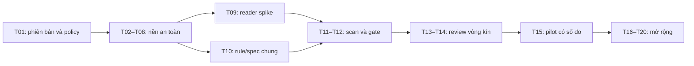

# PointSnap 3D — Kế hoạch triển khai và nghiệm thu

**Ngày:** 26/10/2026. Đọc cùng [báo cáo nghiên cứu](../NGHIEN_CUU_HOAN_THIEN_POINTSNAP_3D.md) và [bài toán bàn giao](../BAI_TOAN_VA_BAN_GIAO_PHAT_TRIEN.md). Mọi hợp đồng/SLO dưới đây là thiết kế đề xuất, chưa là tính năng đã triển khai.

## 1. Quy tắc dùng backlog

- **P0:** điều kiện an toàn và khả năng hoàn thành luồng pilot.
- **P1:** tăng năng suất, độ phủ và chất lượng review sau nền P0.
- **P2:** phụ thuộc dữ liệu/hạ tầng hoặc giá trị chưa được đo.
- Mỗi task có test hồi quy, bằng chứng nghiệm thu và điều kiện đóng. Chỉ đổi trạng thái “xong” khi đủ những đầu ra đó.
- Giữ một nhánh phát triển tích hợp nhỏ; pin revision, phiên bản CVAT/browser và guideline trong artifact phát hành. Không có ước lượng số tuần khi chưa biết nhân lực/quyền/dữ liệu mẫu.

## 2. Backlog theo thứ tự phụ thuộc

| ID | Mức / mốc | Việc cụ thể | Đầu ra và điều kiện đóng |
|---|---|---|---|
| T01 | P0 / M0 | Chốt CVAT/browser, role, dữ liệu mẫu, retention/sync/journal | Compatibility manifest và data-policy matrix được chủ dự án xác nhận |
| T02 | P0 / M1 | Đóng false-pass khi `lidar_missing` thiếu cloud/pose | Coverage độc lập với finding; regression cho job có box và không có box |
| T03 | P0 / M1 | Journal và recovery batch | Có trạng thái từng entry; fault injection mọi vị trí; recovery lỗi không mất nhật ký |
| T04 | P0 / M1 | Revision/cache invalidation | Label/occluded/peer attrs/track dims/spec/cloud đổi đều cập nhật; bỏ response cũ |
| T05 | P0 / M1 | Sửa xóa range và schema guideline | Ô trống có semantics thống nhất; Save/reload/import/export giữ đúng; có version/hash |
| T06 | P0 / M1 | An toàn box roll/pitch và thinning | Chặn thao tác chưa hỗ trợ hoặc giữ đúng invariant hình học; giữ mốc ngữ nghĩa |
| T07 | P0 / M1 | Củng cố adapter và browser test | Contract/capability test, Chromium persistent fixture, smoke CVAT mục tiêu, Save/Undo/reload |
| T08 | P0 / M1 | Cài đặt tái lập và tài liệu hiện trạng | Khôi phục test backend cần thiết, CI, dependency lock/tool manifest và `.gitignore`; cài sạch chạy được các đường được công bố |
| T09 | P0 / M2 | Spike hai frame reader | So cvat-core và REST chunk trên mapping/quyền/player contention; có decision record |
| T10 | P0 / M2 | Hợp nhất rule engine/spec | Dùng JS thuần cho annotator và QC; cùng input/spec cho cùng result; registry khai báo dependencies |
| T11 | P0 / M2 | Scan scheduler và bộ nhớ | Theo lô, cancel, generation, cache budget, source draft/saved rõ; lỗi frame vào coverage |
| T12 | P0 / M2 | QC list và gate | Gộp track, filter, chọn đúng box; PASS/FAIL/INCOMPLETE theo contract ở mục 4 |
| T13 | P0 / M3 | Review store và reconcile | Giữ quyết định theo revision; đổi ID mơ hồ thành stale; không mang review sang nhãn khác |
| T14 | P0 / M3 | Trả lỗi và nộp lại | Finding panel là đường cơ bản; store dùng chung theo policy; Issues adapter chỉ bật nếu spike đầu cuối đạt |
| T15 | P0 / M4 | Holdout mới và báo cáo pilot | Khóa dữ liệu/version trước tuning; QC đáp án; báo chất lượng, coverage, harmful edits và UX |
| T16 | P1 / M5 | Gợi ý frame tham chiếu, nhập số, preset class | Đo time-to-Save và lỗi còn lại; có preview/Undo và giới hạn loại vật |
| T17 | P1 / M5 | Delta/thuộc tính theo dải frame | Scope rõ; giữ mốc outside/occluded; test concurrent edit và recovery |
| T18 | P1 / M5 | Trùng track, review coverage, diff lần nộp | Có tập lỗi thật; không tự ghép ID; đo precision từng phép kiểm |
| T19 | P2 / M5 | GroundGrid/Patchwork++/WASM spike | Cùng protocol/ROI, đo end-to-end; chỉ tích hợp khi lợi ích bù chi phí |
| T20 | P2 / M5 | Camera/pose/ML/server batch | Có data permission/calibration/pose, model manifest và benchmark riêng |



## 3. Hợp đồng dữ liệu đích

Các ví dụ sau là schema logic, cần chuyển thành JSON Schema/type và version migration khi triển khai.

### 3.1 Scope và nguồn dữ liệu

```text
JobScope = { origin, projectId?, taskId, jobId }
ObjectRef = { scope, kind: track|shape, serverId, frame }
Revision = { annotationDigest, cloudRevision, guidelineHash, engineVersion, generation }
DataSource = DRAFT_SESSION | SAVED_SERVER
```

- `origin` được chuẩn hóa theo scheme/host/port; path proxy cần hợp đồng riêng. Không nhập nhằng hai CVAT có cùng job ID.
- `clientID` chỉ dùng trong phiên để chọn đối tượng; adapter giữ ánh xạ về `ObjectRef`, không dùng làm khóa review bền.
- Cloud revision có thể từ metadata/checksum có thật ở bản CVAT mục tiêu; đây không phải giả định CVAT luôn cấp một ETag phù hợp.
- Scan draft cần theo dõi thay đổi trong phiên, digest/validation đầu và cuối. Nếu chưa chứng minh snapshot nhất quán thì giữ run stale/incomplete; không lấy bản GET server thay cho phần sửa chưa Save.
- Job có frame start/step/deleted frames phải dùng mapping từ adapter. `lidar_missing` cần enumerate frame từ metadata cả khi job chưa có annotation.

Căn cứ: [CVAT reader/API evidence](cvat-evidence.md), [quy ước tọa độ](../CONVENTIONS.md).

### 3.2 Rule registry

```text
RuleDefinition = {
  id, version, label, applicableClasses,
  unit: box|frame|track|pair,
  requires: annotations|cloud|pose|camera|calibration|model,
  supportsTilt, minEvidence, defaultSeverity,
  parametersSchema, evaluate, explain
}
```

- Một nguồn registry cho công tắc, UI, dependency và coverage. Guideline chứa tham số cùng trạng thái bật/bắt buộc/ảnh hưởng gate.
- Thiếu GPU/model/cloud là trạng thái khả dụng, không tự biến luật đã được yêu cầu thành luật tắt.
- Phân biệt yaw trục vật và hướng đầu/đuôi; phép đối xứng dùng theo luật/class.
- Python runner tương lai dùng schema và golden cases chung; mọi khác biệt thuật toán được version hóa và giải thích.

### 3.3 Execution result tách khỏi finding

```text
RuleExecution = {
  ruleId, scope, revision, unit,
  eligible, tested, abstained, failed, pending, notApplicable,
  reasonsByCode, frameRanges, findings
}
Finding = {
  findingId, objectRef?, frameWindow, ruleId, severity,
  measuredValue, threshold, units, evidence, evidenceQuality,
  revision, instruction, proposal?
}
```

Invariant đề xuất: `eligible = tested + abstained + failed + pending`; `notApplicable` nằm ngoài eligible. Denominator lấy từ scope đầu vào của luật, không từ các mẫu chạy thành công. Nếu chất lượng bằng chứng không đạt thì mẫu vào abstained, không counted như một phép kiểm đầy đủ.

`evidenceQuality` là chỉ số hỗ trợ/heuristic nếu chưa hiệu chuẩn. UI không hiển thị nó thành xác suất “box sai” đã được chứng minh.

### 3.4 Review và reconciliation

```text
ReviewDecision = {
  id, findingId, objectIdentity, inputRevision,
  verdict: confirmed|false_positive|needs_context,
  reviewer, timestamp, reason?, supersedes?
}
FindingLifecycle = active | resolved | stale | orphaned
```

- Review cũ được giữ lịch sử; khi source/spec/engine đổi, đối chiếu theo identity/rule/scope và bằng chứng.
- Khi geometry đã đổi, không giữ nguyên kết luận như thể đã kiểm bản mới. Re-evaluate rồi resolved hoặc stale theo chính sách.
- Nếu server IDs đổi: candidate matching có thể hỗ trợ con người, nhưng chỉ tự nối khi định danh duy nhất được kiểm chứng; mọi mơ hồ thành orphaned/stale.
- Dismiss cục bộ là preference/ngoại lệ có provenance; không xóa finding khỏi thống kê detector một cách âm thầm.
- Tiến độ track “xong” không thay cho review finding hoặc chấp nhận job.

## 4. Gate và coverage

### Thứ tự xử lý đề xuất

1. Run chưa xong, canceled, lỗi nguồn, revision cũ: không cấp PASS.
2. Không có luật hoạt động hoặc không có phép kiểm áp dụng được để kết luận: `INCOMPLETE`, kèm reason như `NO_ACTIVE_RULES`/`NO_APPLICABLE_CHECKS`.
3. Bất kỳ luật bắt buộc áp dụng được còn pending/failed/abstained ngoài allowance đã chốt: `INCOMPLETE`.
4. Đã đủ phạm vi nhưng finding vượt policy gate: `FAIL`.
5. Đủ phạm vi và trong ngưỡng: `PASS_IN_SCOPE`, kèm scope/revision/coverage. Đây là kết quả tự động theo policy, không tự nhận là quyết định cuối của reviewer.

Policy có thể cho phép phần thiếu bằng chứng với ngưỡng đã được QC chốt; allowance phải hiển thị và version hóa, không tự suy từ số finding.

### Regression bắt buộc

| Ca | Mong đợi |
|---|---|
| Chỉ `lidar_missing` bật, cloud absent | INCOMPLETE, lý do thiếu cloud |
| Có cloud nhưng thiếu pose cho phép kiểm chuyển động | INCOMPLETE cho phép kiểm bắt buộc đó |
| Job không có box nhưng có frame và luật tìm sót vật | Reader vẫn lấy scope frame; không bỏ scan vì danh sách annotation rỗng |
| Camera/model thiếu khi luật bắt buộc được chọn | INCOMPLETE và tên dependency |
| Luật không áp dụng cho class của job | N/A rõ ràng; không khai là đã kiểm geometry |
| Hủy giữa job / frame decode lỗi | Pending/failed vào mẫu số, run có trạng thái đúng |
| Người dùng sửa box lúc scan | Kết quả cũ stale hoặc rescan phần ảnh hưởng trước gate |
| Không finding, mọi phép kiểm bắt buộc thực sự hoàn tất | PASS_IN_SCOPE nếu policy cho phép |

## 5. Journal và giao thức mutation

```text
Operation = {
  operationId, scope, planHash, inputRevision, state,
  entries: [{ objectRef, before, after, status, error? }],
  retentionPolicy, createdAt, serverPersistenceEvidence?
}
```

### Invariant an toàn đề xuất

1. Journal được ghi thành công vào nơi cho phép trước lần đổi state đầu tiên. Nếu policy chỉ cho RAM, nói rõ chỉ phục hồi trong phiên; tính năng quảng bá crash recovery phải có lưu bền được phê duyệt.
2. Một phạm vi mutation tại một thời điểm; không vô tình lồng hai thao tác freeze/Undo. Adapter quản lý cleanup và capability thực tế của history.
3. Chụp đủ pre-state cả hình học/keyframe/trạng thái/thuộc tính mà thao tác có thể tác động. Plan chỉ đổi các trường đã công bố.
4. Trước mỗi entry kiểm identity, revision, lock và state còn phù hợp; khác thì dừng/cập nhật preview hoặc conflict.
5. Mỗi lần save/refresh/unfreeze/recovery lỗi vẫn trả hoặc giữ Operation với phần đã làm; exception không được làm mất đường phục hồi.
6. Undo/compensation chỉ restore nếu state còn trùng post-state. Thay đổi tiếp theo được giữ và báo conflict.
7. Hủy thao tác ghi được xử lý ở entry boundary theo kế hoạch recovery, không coi abort HTTP là chứng minh chưa có thay đổi.
8. `APPLIED_UNSAVED` thể hiện đúng thay đổi trong CVAT session. Server persistence chỉ được ghi nhận khi adapter có bằng chứng, nghiệm thu bằng Save/reload.

Cơ sở nền tảng: [CVAT history/saveStates](cvat-evidence.md), [vòng đời/lưu trữ extension](extension-evidence.md). Đây là thiết kế phục hồi bù, không là giao dịch atomic hoặc khóa chỉnh sửa nhiều người.

## 6. Reader, scheduler và ngân sách hiệu năng

### Spike reader T09

Chạy hai phương án trên cùng fixture và CVAT target:

- A: cvat-core reader, dữ liệu phiên nhãn và decode của job.
- B: REST chunk cùng session/origin + decoder PCD độc lập, annotation source được chọn rõ.

Chấm theo mapping đúng, capability/quyền, draft consistency, tác động khi player đổi frame, peak memory, tốc độ cold/warm và lỗi/cancel. Chọn theo kết quả; số đo cache nóng một frame không đại diện scan toàn job. [Frame decoder evidence](cvat-evidence.md)

### Scheduler

- Quét tuần tự hoặc concurrency nhỏ có giới hạn theo spike; ưu tiên thao tác người dùng hơn prefetch.
- Worker/CSP là capability cần thử; fallback xử lý chunk và nhường event loop.
- Sao chép trước khi transfer dữ liệu CVAT sở hữu. Không giữ raw cloud cả job trong storage.
- Cache PointSnap theo byte/frame, có telemetry cục bộ; phân biệt phần bộ nhớ CVAT vốn có với phần tăng thêm do extension.
- Cancel tăng generation; bỏ response cũ và ghi checkpoint được phép. Resume phải kiểm revision.

### Mục tiêu pilot đề xuất, cần đo trước khi cam kết

| Phép đo | Mục tiêu thử nghiệm |
|---|---|
| Checklist cho box sau khi frame/index đã sẵn sàng | p95 ≤ 100 ms trên profile thiết bị và cloud được công bố |
| UI khi scan | Điều khiển vẫn phản hồi; báo long tasks và dropped interactions |
| Cancel scan | p95 ≤ 1 giây sau yêu cầu trên profile công bố; phần chưa xong là pending |
| Cache PointSnap | Có hard limit cấu hình theo byte, LRU/eviction và xử lý item quá lớn; đo budget phù hợp từ baseline |
| Job dài | Bộ nhớ phần raw-cloud cache không tăng tuyến tính theo số frame |

Các giá trị trên là tiêu chí thử nghiệm do nghiên cứu đề xuất, không suy từ số đo GroundGrid hay lời giới thiệu sản phẩm khác. Nếu chưa đạt, profile và điều chỉnh phạm vi/thiết kế trước khi chốt SLO phát hành.

## 7. Test matrix cần triển khai

| Lớp | Nội dung ưu tiên | Bằng chứng bàn giao |
|---|---|---|
| Unit domain | NaN/Infinity, kích thước dương, rotation, min-Z, ±π | Seed/fixture và assertion invariant |
| Unit geometry | Slope/curb, overpass, reflection, sparse/occluded, vật sát tường | Expected result hoặc abstain rõ |
| Unit rules | Size/class/attrs/overlap/heading; mỗi điều kiện applicability | Cùng input/spec, annotator và QC cho cùng result |
| Unit planning | Size sync, yaw và thinning với outside/occluded/attrs | Invariant bảo toàn và golden interpolation CVAT |
| Unit cache | Thay label/occluded/spec/peer/track dims/cloud | Phép đo mới; response revision cũ bị loại |
| Adapter | Job boundaries, frame step/deleted, missing chunk, session hết hạn | Mapping chính xác; coverage và lỗi quyền đúng |
| Fault injection | Lỗi save thứ 1/giữa/cuối; lỗi refresh/unfreeze/recovery | Trạng thái mọi entry xác định; journal còn khi chưa phục hồi hết |
| Concurrency | User chỉnh tiếp, hai tab, scan lúc kéo/chuyển frame | Không trộn scope, overwrite hay tạo false pass |
| Bridge | Message sai schema/scope, quá lớn, URL tùy ý, permission revoked | Quyền không bị mở rộng; lỗi có thể giải thích |
| Browser MV3 | Grant/deny/revoke, worker sleep/restart, SPA navigation | Context stale được xử lý; cleanup hoàn chỉnh |
| E2E CVAT | Preview → Apply → Save → reload; Undo → Save → reload | So nhãn trước/sau và video/log test |
| Re-review | Finding còn/sửa/xóa/ID đổi/ambiguous/spec đổi | Quyết định không gắn nhầm; lịch sử còn truy vết |
| Accessibility | Icon-only/hẹp, keyboard, focus, toggle và input | Accessible names và thao tác cơ bản còn đúng |
| Performance | Cloud/job nhỏ, điển hình, cực hạn được cho phép | p50/p95, memory, cancellation và cấu hình máy |

Test chính tập trung hành vi mất nhãn, sai identity, thiếu bằng chứng và lỗi giữa chừng; tránh tăng số lượng bằng test lặp lại chi tiết implementation. Tooling đề xuất: Node unit tests hiện có, fixture adapter và Playwright Chromium persistent context. Hướng dẫn Playwright hiện dùng bundled Chromium; cần smoke riêng trên Chrome/Edge mục tiêu. [Playwright](https://playwright.dev/docs/chrome-extensions), [WAI button](https://www.w3.org/WAI/ARIA/apg/patterns/button/)

## 8. Protocol benchmark

### Bước 1 — Khóa manifest

Ghi dataset/log/scene/frame, sensor/coordinate frame, preprocessing, spec, engine/build, corruption seed, ROI, ignore classes và bản CVAT/browser. Tạo development set và holdout chưa dùng chỉnh ngưỡng. Các cảnh mini đã tham gia tinh chỉnh chỉ dùng development/regression. [Holdout caveat](lidar-evidence.md)

### Bước 2 — Tạo đáp án và chọn mẫu

- Public ground truth chỉ dùng đúng phạm vi/định nghĩa dataset. AV2 ground raster cần chuyển sang city và mask vùng hợp lệ; ghi lỗi map/ROI thành thiếu tham chiếu.
- Tập lỗi thật được QC gán loại và đáp án, có người thứ hai xử lý bất đồng. Giữ mẫu chưa rõ riêng.
- Để đo recall, review cả mẫu ngẫu nhiên trong vùng không có finding. Precision từ danh sách đã báo không chứng minh không bỏ sót.
- Tách split theo scene/log; với nhóm dữ liệu tương quan, ước lượng uncertainty theo nhóm hoặc báo từng nhóm. [GroupKFold](https://scikit-learn.org/stable/modules/generated/sklearn.model_selection.GroupKFold.html)

### Bước 3 — Chạy ba tầng đánh giá

1. Ground mask: precision/recall/IoU với taxonomy cố định.
2. Terrain: bias và sai số cao độ, phân loại quan sát/nội suy/abstain.
3. Annotation QC và action: finding precision/recall, false alarm rate, lỗi trước/sau và harmful edit rate.

nuScenes mAP/ATE dùng tâm 2D nên cần metric đứng riêng cho đáy; không thay bằng NDS. Mỗi dataset có protocol riêng. [nuScenes metrics](https://github.com/nutonomy/nuscenes-devkit/blob/master/python-sdk/nuscenes/eval/detection/README.md), [LiDAR protocols](lidar-evidence.md)

### Bước 4 — Báo kết quả và quyết định

| Chỉ số | Cách công bố |
|---|---|
| Finding precision | `confirmed / (confirmed + false_positive)` trên mẫu đã adjudicate, kèm số unresolved và cách lấy mẫu |
| Finding recall | Lỗi phát hiện / tổng lỗi có đáp án trong vùng audit; tách lỗi chèn với lỗi thật |
| Coverage | Tested/eligible theo từng luật và reason của phần còn lại |
| Harmful edit rate | Số đề xuất làm sai số xấu hơn / số đề xuất có đáp án before/after; báo độ lớn thay đổi |
| UX | Thời gian chủ động tới Save, số thao tác, lỗi còn lại; cùng task difficulty, thứ tự đối trọng |
| Uncertainty | Khoảng tin cậy và mẫu số; Wilson khi giả định tỷ lệ phù hợp, xử lý nhóm khi cần |

Ví dụ thống kê để đọc báo cáo, **không là số đo của PointSnap**: 90 finding đúng trên 100 mẫu độc lập có Wilson 95% xấp xỉ 82,6%–94,5%, nên không chỉ ghi một con số 90%. Phụ thuộc theo track và sampling bias cần đánh giá riêng. [NIST](https://www.itl.nist.gov/div898/handbook/prc/section2/prc241.htm)

Chủ dự án chốt ngưỡng precision/recall/harmful edit/time saving sau baseline và chi phí nghiệp vụ. Không có cơ sở để đặt một ngưỡng centimet hoặc precision chung cho mọi sensor/class.

## 9. Điều kiện phát hành và rollback

### Gate phát hành pilot đề xuất

- Các ca scope/identity/recovery/coverage bắt buộc đều đạt; không còn ca mất nhật ký chưa được xử lý trong fault suite.
- Quy tắc dữ liệu cho host metadata, journal, review store và export có cấu hình áp dụng thực tế.
- Có CVAT/browser matrix; đường ghi ngoài capability được chặn và giải thích.
- Holdout chưa dùng tuning, kết quả và hạn chế được bàn giao; luật chưa đủ chất lượng để advisory/disabled theo policy đã chốt.
- Save/reload và Undo/reload đã qua trên job thử; hướng dẫn phân biệt session state và server persistence.
- Tài liệu hiện trạng và đường dẫn cài đặt đúng với package phát hành.

### Gói bàn giao mỗi bản

Revision/tag + extension package/checksum; dependency/tool manifest; rule/spec schema/version; compatibility matrix; test log và fixtures được phép chia sẻ; benchmark report; known issues; data retention/cleanup; hướng dẫn cập nhật/rollback. Backend tùy chọn cần thêm config/storage migration và smoke cài sạch.

### Rollback

1. Dừng scan/mutation mới; ghi lại operation đang pending và xử lý phục hồi.
2. Xác minh trạng thái CVAT đã Save; giữ journal cần điều tra theo policy.
3. Đổi về extension/build và spec tương thích; migration/review store có version và đường phục hồi.
4. Chạy smoke đọc, selection, preview, quyền và Save/Undo trên job thử trước khi quay lại công việc.

Các bước này là runbook đích; chưa có release/rollback mới được thực hiện trong nghiên cứu.

## 10. Những việc có thể bắt đầu ngay

1. Bổ sung regression cho năm lỗi đã xác minh và thiết kế journal T02–T06.
2. Tách rule registry/schema và cache revisions trên code hiện có.
3. Chuẩn bị adapter fixtures, golden interpolation và browser smoke manifest.
4. Đánh dấu các kết quả cũ là development evidence; lập mẫu benchmark manifest mới.
5. Thử reader trên CVAT local theo đúng các ca mapping/concurrency trước khi triển khai vào hệ thống công ty.

Quyền truy cập công ty, khả năng giữ journal qua reload và ngưỡng nghiệm thu còn là quyết định của chủ dự án. Các sửa lỗi nền và fixture độc lập vẫn tiến hành được.
